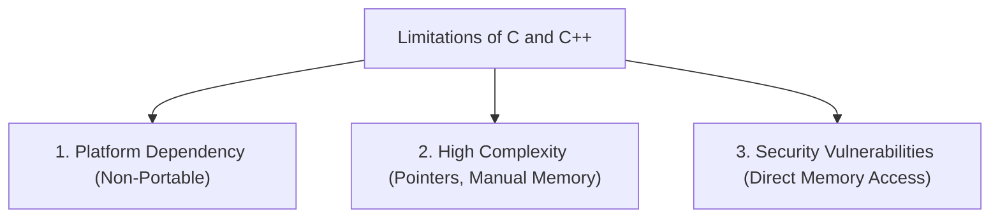
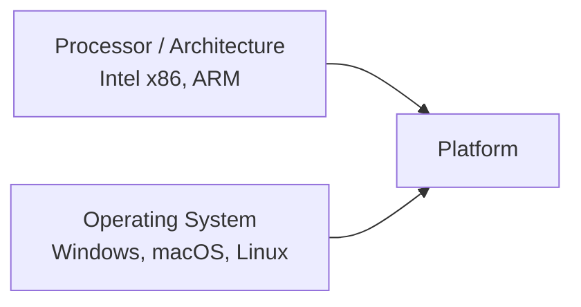
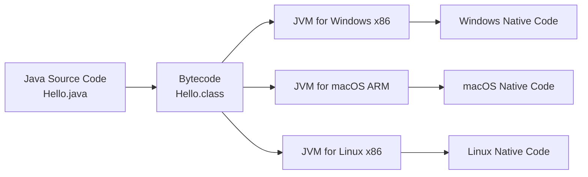
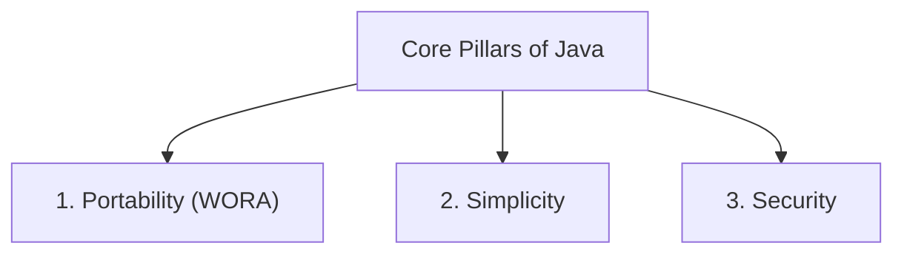
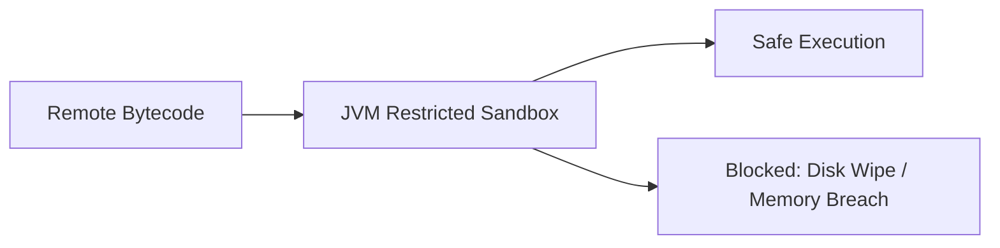

# Core Java — Lecture 01: Core Architecture & Fundamentals

---

## 1. The Era Before Java & The Dominance of C/C++
* During the 1980s and 1990s, **C and C++** were the industry standards.
* **Key Strengths**:
  * Extremely fast execution speeds.
  * Very close to hardware (low-level and mid-level control).
  * Direct access to memory and CPU registers with minimal runtime overhead.
* **The Evolution of Execution**:
  Machine Code (0s & 1s) &rarr; Assembly (ADD, MOV) &rarr; High-Level (C, C++) &rarr; Java (Bytecode + JVM)

---

## 2. The Core Problems with C/C++

C and C++ suffered from three critical architectural limitations that led to the creation of Java:

### Problem 1: Platform Dependency (Lack of Portability)
* C/C++ source code is compiled directly into **native machine code** (zeros and ones).
* This machine code is tied directly to the specific target system.
* A binary compiled on Windows (Intel x86) will not run on macOS (ARM).
* To run the program on another system, the developer must recompile the source code on that specific platform.

### Problem 2: High Language Complexity
* **Pointers & Pointer Arithmetic**: Prone to dangling pointers, wild pointers, and memory corruption.
* **Multiple Inheritance in Classes**: Creates ambiguity issues (the "Diamond Problem").
* **Manual Memory Management**: Programmers have to manually allocate (`malloc` / `new`) and deallocate (`free` / `delete`) memory. Forgetting to deallocate leads to system memory leaks and crashes.

### Problem 3: Low Security
* Direct access to physical memory addresses via pointers enables buffer overflows and unauthorized memory manipulation.

---

## 3. What is a "Platform"?

A platform is defined by two tightly coupled components:

$$\text{Platform} = \text{Processor (CPU Architecture)} + \text{Operating System (OS)}$$

### Why Do Different Platforms Produce Different Binaries for the Same Code?

#### Reason 1: Differences in the Operating System (OS Layer)
* Programs cannot directly draw on the screen, write to files, or allocate memory. They must make **System Calls** to the OS.
* Different operating systems provide entirely different system libraries and system call conventions:
  * Printing to the console on **Windows** invokes internal Windows APIs (e.g., `WriteFile`).
  * Printing to the console on **Linux / macOS** invokes POSIX system calls (e.g., `sys_write`).
* Compiled native machine code bakes in these OS-specific library calls.

#### Reason 2: Differences in the CPU / Processor (Hardware Layer)
* Processors consist of billions of microscopic transistors operating via voltage signals (1 = ON, 0 = OFF).
* Different CPU architectures (Intel x86 vs. Apple ARM) have completely different physical transistor layouts, pin configurations, and register architectures.
* An operation like `ADD` requires different low-level binary commands on x86 compared to ARM.

### Instruction Set Architecture (ISA)
* **ISA** is the hardware interface and "grammar" that a CPU understands.
* It defines all fundamental CPU instructions (`LOAD`, `STORE`, `ADD`, `JMP`).
* Because x86 and ARM have different ISAs (grammars), machine code generated for one processor is completely unreadable to another.

---

## 4. Java's Solution: Bytecode & The JVM

Java introduced a two-tier compilation and execution pipeline to eliminate platform dependency:

### How Java Works:
1. **Compilation**: The `javac` compiler translates Java source code (`.java`) into an intermediate, universal format called **Bytecode** (`.class`).
2. **Bytecode Characteristics**: Bytecode is an optimized set of instructions designed for an idealized virtual processor. It does **not** contain platform-specific machine code.
3. **Execution**: The **Java Virtual Machine (JVM)** reads the Bytecode line-by-line and translates it into the native machine code of the underlying host operating system and processor.

> [!IMPORTANT]
> **Core Architectural Distinction**:
> * **Java Bytecode is Platform Independent**: The exact same `.class` file runs across Windows, macOS, and Linux.
> * **The JVM is Platform Dependent**: Every platform has a custom-built JVM (e.g., a JVM specifically written for Windows x86, another for macOS ARM).

---

## 5. The Three Pillars of Java

### 1. Portability — WORA (Write Once, Run Anywhere)
* Developers compile their code once into Bytecode.
* That Bytecode can run on any device, operating system, or server that has a compatible JVM installed.
* **Why this mattered**: The 1990s saw the rapid growth of the Internet, heterogeneous web servers, and consumer electronics (smart TVs, set-top boxes). Developers needed a single language that didn't require separate builds for every environment.

### 2. Simplicity
Java intentionally stripped out dangerous and confusing features of C++:
* **No Pointers**: Direct memory addressing and pointer arithmetic were eliminated. Java uses managed object references instead.
* **No Multiple Inheritance of Classes**: Eliminates ambiguity and the diamond problem (handled cleanly via Interfaces).
* **Automatic Memory Management**: The **Garbage Collector (GC)** runs in the background to automatically identify and reclaim unused heap memory, eliminating manual `free` / `delete` errors.

### 3. Security & The JVM Sandbox Model
* **The Problem**: In the early days, Java was used both on the backend (Servlets) and the frontend (Applets running inside web browsers). Code downloaded over the internet from unknown sources could be malicious.
* **The Sandbox Model**:
  * The JVM executes Bytecode inside a strictly managed, restricted execution space (sandbox).
  * Untrusted code cannot directly interact with native host OS resources, read arbitrary local files, or damage the system without verified security permissions.

---

## 6. Why Wasn't C/C++ Made Platform Independent?

* **Feasibility**: C and C++ could theoretically be compiled to an intermediate bytecode executed via a virtual machine (Microsoft later implemented this design with **C# and the .NET CLR**).
* **Core Philosophy**:
  * C and C++ are designed specifically for **system-level programming** (operating system kernels, embedded firmware, high-performance game engines, drivers).
  * Their primary purpose is direct hardware control, predictability, and raw execution speed with zero abstraction cost.
  * Adding a bytecode interpretation layer or runtime VM would defeat their primary design goal.

---

## 7. C/C++ vs. Java: Direct Comparison

| Feature | C / C++ | Java |
| :--- | :--- | :--- |
| **Primary Focus** | Maximum execution speed, direct hardware control | Portability, enterprise reliability, memory safety |
| **Compilation Target** | Native Machine Code (0s & 1s) | Intermediate Bytecode (`.class` file) |
| **Portability** | Platform Dependent (Recompile per platform) | Platform Independent (Write Once, Run Anywhere) |
| **Execution Layer** | Directly by the CPU & OS | Java Virtual Machine (JVM) |
| **Memory Management** | Manual (`malloc` / `free`, `new` / `delete`) | Automatic Garbage Collection (GC) |
| **Pointer Arithmetic** | Supported & widely used | Disallowed; memory addresses are abstracted |
| **Security Layer** | Relies on OS controls & developer discipline | JVM Sandbox & Bytecode Verification |
