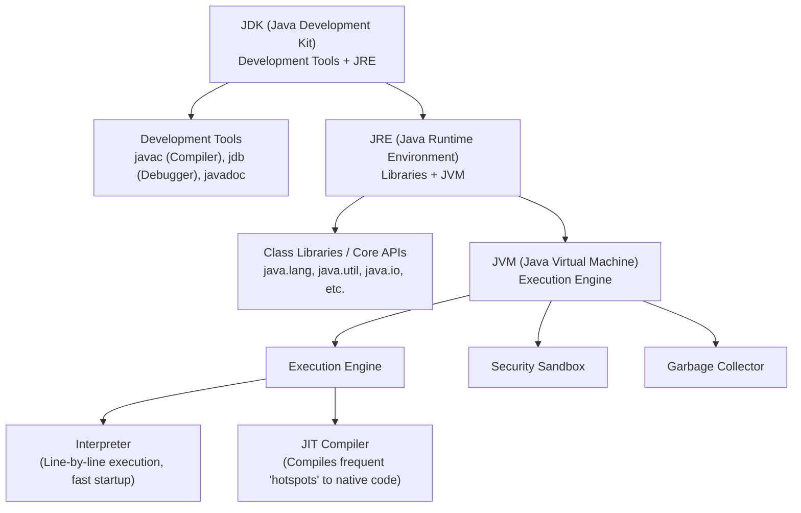
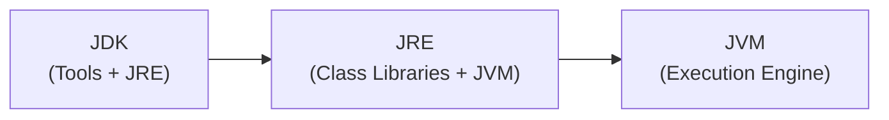
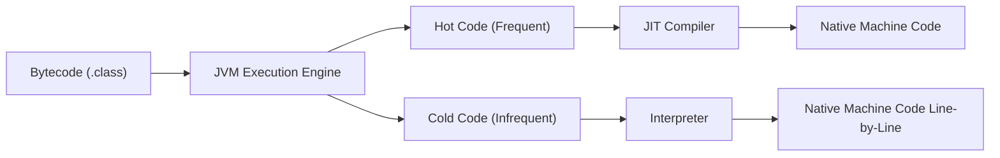
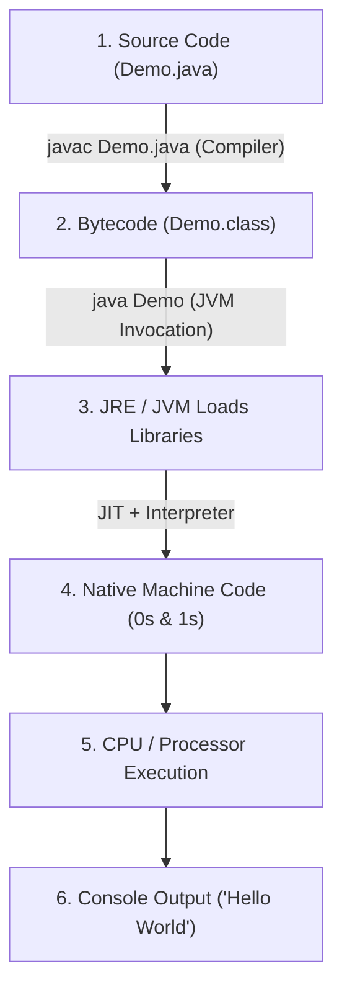

# Core Java — Lecture 02: JVM, JRE, JDK & First Java Program

---

## 📌 Mindmap



---

## 1. Hierarchy: JDK vs. JRE vs. JVM

Java execution and development is structured as three concentric layers:



* **JVM (Java Virtual Machine)**:
  * Innermost engine.
  * Responsible for executing Bytecode (`.class`) and translating it into host-specific Machine Code.
  * Provides memory management (Garbage Collection) and security sandboxing.
* **JRE (Java Runtime Environment)**:
  * Formula: $\text{JRE} = \text{JVM} + \text{Class Libraries}$
  * Contains the runtime packages, standard utility libraries, and core APIs needed to **run** an existing Java application.
* **JDK (Java Development Kit)**:
  * Formula: $\text{JDK} = \text{JRE} + \text{Development Tools}$
  * The full software bundle needed to **develop, compile, and debug** Java applications.
  * Includes `javac` (compiler), `jdb` (debugger), `javadoc`, and other CLI developer utilities.

---

## 2. JVM Internals: How Bytecode Executes



### Compiler vs. Interpreter (The Core Trade-off)
* **Compiler**: Reads and converts the entire source code into machine code all at once before execution.
  * *Advantage*: Very fast execution once compiled.
  * *Disadvantage*: Slow initial build/compilation startup time.
* **Interpreter**: Reads and translates source code line-by-line, executing instructions on the fly.
  * *Advantage*: Starts execution immediately with minimal startup delay.
  * *Disadvantage*: Slower execution speed for loops and repetitive tasks because the same instructions are interpreted repeatedly.

### Is Java Compiled or Interpreted?
**Java is both.**
1. **Ahead-of-Time Step**: `javac` compiles `.java` source code into platform-independent `.class` Bytecode.
2. **Runtime Step**: Inside the JVM, a **hybrid engine** combines an Interpreter with a **JIT (Just-In-Time) Compiler**:
   * **Interpreter**: Begins executing Bytecode instructions line-by-line immediately for fast application startup.
   * **JIT Compiler**: Monitors code while running and detects repetitive code blocks ("hotspots", frequent loops/methods). It compiles these hotspot sections directly into native machine code so they never need re-interpretation.

### Primary Functions of the JVM
1. **Bytecode to Machine Code Translation**: Handled by the hybrid Interpreter + JIT engine.
2. **Security Sandbox Model**: Runs untrusted/downloaded bytecode in a restricted virtual environment to prevent unauthorized memory access or arbitrary filesystem destruction.
3. **Automatic Garbage Collection (GC)**: Continuously monitors heap memory and automatically deletes unreferenced objects.

---

## 3. Java Editions: JSE vs. JEE vs. JME

| Edition | Full Name | Primary Target & Description | Current Status |
| :--- | :--- | :--- | :--- |
| **JSE** | Java Standard Edition | **Core Java**. Includes fundamental OOP principles, core APIs (`java.lang`, `java.util`), multithreading, collections, and I/O. | **Active & Foundational** (Basis for all Java development) |
| **JEE** | Java Enterprise Edition *(Now Jakarta EE)* | Extended enterprise libraries for distributed systems, backend web applications, transactions, and enterprise microservices (e.g., Spring Boot ecosystem). | **Active** (Modern Enterprise Backend) |
| **JME** | Java Micro Edition | Lightweight subset designed for early resource-constrained mobile phones and embedded systems. | **Obsolete** (Replaced by modern Android OS / Kotlin) |

---

## 4. End-to-End Execution of a Java Program



### Step-by-Step CLI Workflow:

#### Step 1: Write Source Code (`Demo.java`)
```java
public class Demo {
    public static void main(String[] args) {
        System.out.println("Hello World");
    }
}
```

#### Step 2: Compile to Bytecode
Run the Java compiler (`javac`) from the terminal:
```bash
javac Demo.java
```
* **Output**: Produces an intermediate platform-independent file: `Demo.class`.
* *Note*: Opening a `.class` file in editors like VS Code triggers an internal decompiler (e.g., Fernflower) because raw bytecode consists of binary JVM opcodes.

#### Step 3: Execute via the JVM
Invoke the Java runtime launcher:
```bash
java Demo
```
* **Action**: The JVM loads `Demo.class`, dynamically links standard runtime class libraries from the JRE, translates the bytecode using its Interpreter and JIT compiler into native instructions, and executes it via the host CPU.
* **Console Output**:
```text
Hello World
```

---

## 5. Architectural Takeaways

1. **JDK contains JRE; JRE contains JVM**.
2. **Bytecode is universal**, but the **JVM is platform-specific**.
3. **Java balances fast startup with peak performance** by dynamically pairing an Interpreter with a JIT Compiler.
4. **Core Java is based on JSE (Java Standard Edition)**; web and enterprise frameworks build on the JEE / Jakarta EE specification.
