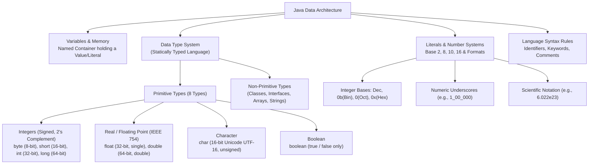
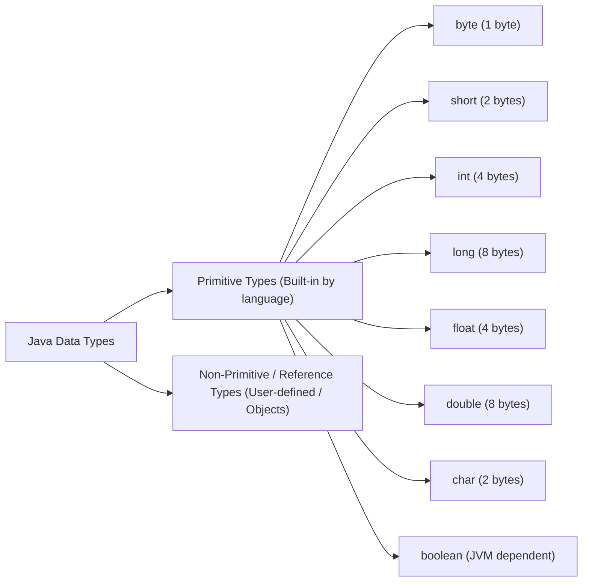
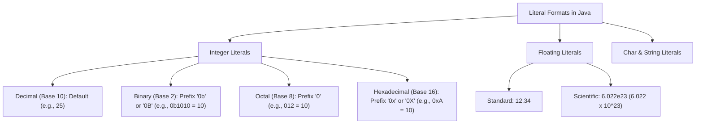

# Core Java — Lecture 03: Variables, Data Types, Literals & Identifiers

---

## 📌 Mindmap



---

## 1. What is a Variable? (Memory & Container Analogy)

* **Definition**: A variable is a named storage location in physical RAM that holds a data value during program execution.
* **Analogy**: Think of a variable as a labeled container.
  * **Identifier (Label)**: The name given to access the container (e.g., `firstNumber`, `age`).
  * **Literal (Value)**: The actual data stored inside (e.g., `10`, `3.14`, `'A'`).
  * **Data Type**: Determines the size and shape of the container (how many bytes in memory it allocates and what kind of binary patterns are permitted).
* **Why Use Meaningful Names?** Descriptive naming (e.g., `userAge` instead of `x`) makes code self-documenting and maintainable in real-world engineering.

---

## 2. Java Data Type Hierarchy

Java is a **Statically Typed** language, meaning every variable's type must be declared at compile-time before it can be used.



---

## 3. Primitive Data Types: Comprehensive Specifications

All numeric primitive types in Java are **signed** (there is no `unsigned` keyword in Java, except `char` which is an unsigned 16-bit Unicode integer).

| Data Type | Category | Size in Memory | Size in Bits | Min Value | Max Value | Default Value *(Fields)* |
| :--- | :--- | :--- | :--- | :--- | :--- | :--- |
| `byte` | Integer | 1 Byte | 8 bits | $-128$ ($-2^7$) | $127$ ($2^7 - 1$) | `0` |
| `short` | Integer | 2 Bytes | 16 bits | $-32,768$ ($-2^{15}$) | $32,767$ ($2^{15} - 1$) | `0` |
| `int` | Integer *(Default for whole numbers)* | 4 Bytes | 32 bits | $-2,147,483,648$ ($-2^{31}$) | $2,147,483,647$ ($2^{31} - 1$) | `0` |
| `long` | Integer | 8 Bytes | 64 bits | $-2^{63}$ | $2^{63} - 1$ | `0L` |
| `float` | Floating Point | 4 Bytes | 32 bits | $\approx \pm 1.4 \times 10^{-45}$ | $\approx \pm 3.4028235 \times 10^{38}$ | `0.0f` |
| `double` | Floating Point *(Default for decimals)* | 8 Bytes | 64 bits | $\approx \pm 4.9 \times 10^{-324}$ | $\approx \pm 1.7976931348623157 \times 10^{308}$ | `0.0d` |
| `char` | Text / Character | 2 Bytes | 16 bits | `'\u0000'` (or $0$) | `'\uffff'` (or $65,535$) | `'\u0000'` |
| `boolean`| Logical Flag | 1 bit logical *(1 byte in array/JVM)* | N/A | `false` | `true` | `false` |

---

## 4. In-Depth Concepts: Data Types

### A. Why $N$ Bits Yield a Range of $[-2^{N-1} \text{ to } 2^{N-1} - 1]$
* With $N$ bits, the total number of unique combinations is $2^N$.
* Because Java uses **2's Complement representation** for signed integers:
  * 1 bit is reserved for the sign ($0 = \text{positive}$, $1 = \text{negative}$).
  * Remaining $N - 1$ bits hold magnitude.
  * Zero ($0$) takes up one positive slot, leaving positive range reaching only up to $2^{N-1} - 1$.
  * For 8-bit `byte`: Total states $= 2^8 = 256 \implies [-128 \text{ to } +127]$.

### B. Float vs. Double (Single vs. Double Precision)
* **`float` (32-bit single precision)**: Offers $\approx 6 - 7$ significant decimal digits.
* **`double` (64-bit double precision)**: Offers $\approx 15 - 17$ significant decimal digits.
* **Industry Standard**: In production and backend enterprise applications, `double` is universally preferred over `float`:
  1. Modern 64-bit CPU architectures process 64-bit doubles natively with zero performance penalty.
  2. All standard Java math methods (`Math.sin()`, `Math.sqrt()`, `Math.pow()`) return `double`.
  3. Literal decimals like `10.5` default to `double`. To assign a literal to a `float`, an explicit `f` or `F` suffix is mandatory:
     ```java
     float f = 10.54f; // 'f' suffix required
     double d = 23.0987; // 'd' suffix is optional
     ```

### C. Character Type: ASCII vs. Unicode
* **C/C++ Approach**: Uses 8-bit `char` restricted to ASCII ($0 - 127$ / $255$), supporting only standard English characters and basic punctuation.
* **Java Approach**: Designed for global cross-platform compatibility from day one. Java allocates **16 bits (2 bytes)** for `char` to support **Unicode (UTF-16)**:
  * Covers characters from English, Hindi, Mandarin, Arabic, Greek, Japanese, and mathematical symbols.
  * Can be assigned character literals, numeric ASCII/Unicode values, or Unicode escape codes:
    ```java
    char c1 = 'A';          // Character literal
    char c2 = 65;           // Direct ASCII value for 'A'
    char c3 = '\u0041';     // Unicode hex escape for 'A'
    ```

### D. Boolean Type
* Unlike C/C++, Java booleans accept **strictly `true` or `false`**.
* Numeric integers cannot be evaluated as boolean (e.g., `boolean b = 1;` or `if (1)` will throw a compile-time error).

---

## 5. Literals & Number Systems

A **literal** is a fixed source code representation of a constant value.



### Base Prefixes in Java:
1. **Decimal (Base 10)**: Normal numbers (`0` through `9`). Example: `int x = 10;`
2. **Binary (Base 2)**: Starts with `0b` or `0B`. Uses `0` and `1`.
   ```java
   int binVal = 0b1010; // Evaluates to 10
   ```
3. **Octal (Base 8)**: Starts with `0`. Uses digits `0` through `7`.
   ```java
   int octVal = 012; // Evaluates to (1 * 8^1) + (2 * 8^0) = 10
   // int invalid = 08; // Compile Error! 8 is out of range for octal
   ```
4. **Hexadecimal (Base 16)**: Starts with `0x` or `0X`. Uses `0`–`9` and `a`–`f` (where `a=10`, `f=15`).
   ```java
   int hexVal = 0xA; // Evaluates to 10
   int hexMax = 0xFF; // Evaluates to 255
   ```

### Numeric Underscores for Readability (Java 7+)
To make large numbers readable without using commas, underscores (`_`) are allowed between digits:
```java
long creditCard = 1234_5678_9012_3456L;
int population = 1_40_00_00_000;
double pi = 3.1415_9265;
```
* **Rules**: Underscores **cannot** be placed:
  * At the start or end of a number (e.g., `_52` or `52_`).
  * Adjacent to a decimal point (e.g., `3._14` or `3_.14`).
  * Adjacent to `F`, `L`, `D` suffixes or `0b`/`0x` prefixes.

---

## 6. Declaration, Initialization & Definition

* **Declaration**: Tells the compiler the variable's name and type, reserving memory space:
  ```java
  int x; // Declared, uninitialized
  ```
* **Initialization / Definition**: Assigns an initial concrete value to the variable:
  ```java
  x = 10; // Initialized
  ```
* **Combined Declaration & Initialization**:
  ```java
  int x = 10;
  ```

---

## 7. Identifiers: Naming Rules & Conventions

An **identifier** is a symbolic name assigned by the programmer to classes, methods, and variables.

### Mandatory Rules (Enforced by Compiler):
1. **Allowed Characters**: Letters (`a-z`, `A-Z`), digits (`0-9`), dollar signs (`$`), and underscores (`_`).
2. **Cannot Start with a Digit**: `int 1num;` is illegal; `int num1;` is legal.
3. **Case-Sensitive**: `num`, `Num`, and `NUM` are three distinct identifiers.
4. **Cannot Use Reserved Keywords**: `int class = 5;` or `int void = 10;` are compile errors.
5. **No Whitespace or Special Symbols**: Spaces, `@`, `#`, `-`, etc., are illegal.

### Industry Conventions (Not Compiler Enforced):
* **Variables and Methods**: `camelCase` (e.g., `studentName`, `calculateTotalBalance()`).
* **Classes and Interfaces**: `PascalCase` (e.g., `StudentManager`, `ArrayList`).
* **Constants**: `UPPER_SNAKE_CASE` (e.g., `MAX_RETRY_COUNT`, `PI`).

---

## 8. Keywords in Java

* Java has **reserved words** with predefined compiler meanings that cannot be used as identifiers.
* Total reserved keywords: **68+** (including modern additions like `record`, `sealed`, `var`).
* **Historical Reserved Keywords (Unused)**:
  * `goto` and `const`: Reserved by Java's original designers to prevent syntax collision with C++, but have no active implementation in Java.
* **Reserved Literals**: `true`, `false`, and `null` are literals, not keywords, but they also **cannot** be used as identifiers.

---

## 9. Comments in Java

1. **Single-line Comment**:
   ```java
   // This is a single-line comment (ignored by javac)
   ```
2. **Multi-line Comment**:
   ```java
   /* This is a multi-line comment
      used for explaining complex logic */
   ```
3. **Documentation Comment (Javadoc)**:
   ```java
   /**
    * Used for generating official HTML API docs via 'javadoc' tool
    * @param args Command line arguments
    */
   ```

---

## 10. 🎯 College Exam & Interview Boosters (Crucial Edge)

### Booster 1: Default Values vs. Local Variables Trap
* **Instance / Static Variables (Class Fields)**: If declared inside a class but outside methods, the JVM automatically initializes them to default values (`0`, `0.0`, `null`, `false`).
* **Local Variables (Inside Methods)**: **Do NOT get default values!**
  ```java
  public class Test {
      int instanceVar; // Automatically initialized to 0
      
      public void check() {
          int localVar; // NOT initialized
          // System.out.println(localVar); // COMPILE ERROR: Variable localVar might not have been initialized!
      }
  }
  ```

### Booster 2: Integer Overflow & Underflow (Silent Wraparound)
Because primitive integers in Java are signed, adding 1 to the maximum value causes a silent wraparound to the minimum value without throwing an exception:
```java
byte b = 127;
b++;
System.out.println(b); // Prints: -128 (NOT 128!)
```

### Booster 3: Type Promotion in Expressions
When evaluating arithmetic expressions, Java automatically promotes operands smaller than `int` (`byte`, `short`, `char`) to `int`:
```java
byte b1 = 10;
byte b2 = 20;
// byte b3 = b1 + b2; // COMPILE ERROR! Result of (b1 + b2) is promoted to 'int'
byte b3 = (byte)(b1 + b2); // Explicit cast required
```

### Booster 4: Why Does `char` Take 2 Bytes When ASCII Only Needs 1?
* In C/C++, `char` is 1 byte (ASCII, 256 characters max).
* In Java, `char` is 2 bytes (16 bits) because Java uses **Unicode (UTF-16)** to represent international scripts natively (supporting up to 65,536 code points).

### Booster 5: What Happens If You Exceed `long` Range?
* For numbers larger than $2^{63} - 1$ (quadrillions), primitive types overflow.
* Java provides the **`java.math.BigInteger`** and **`java.math.BigDecimal`** classes for arbitrary-precision arithmetic without limits.
