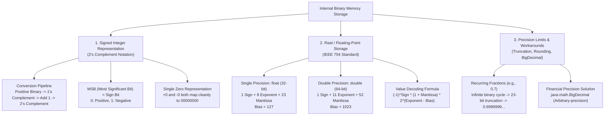
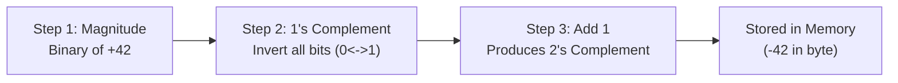
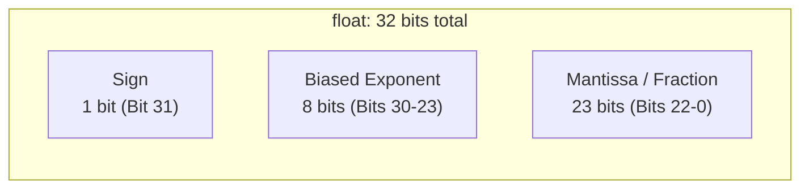
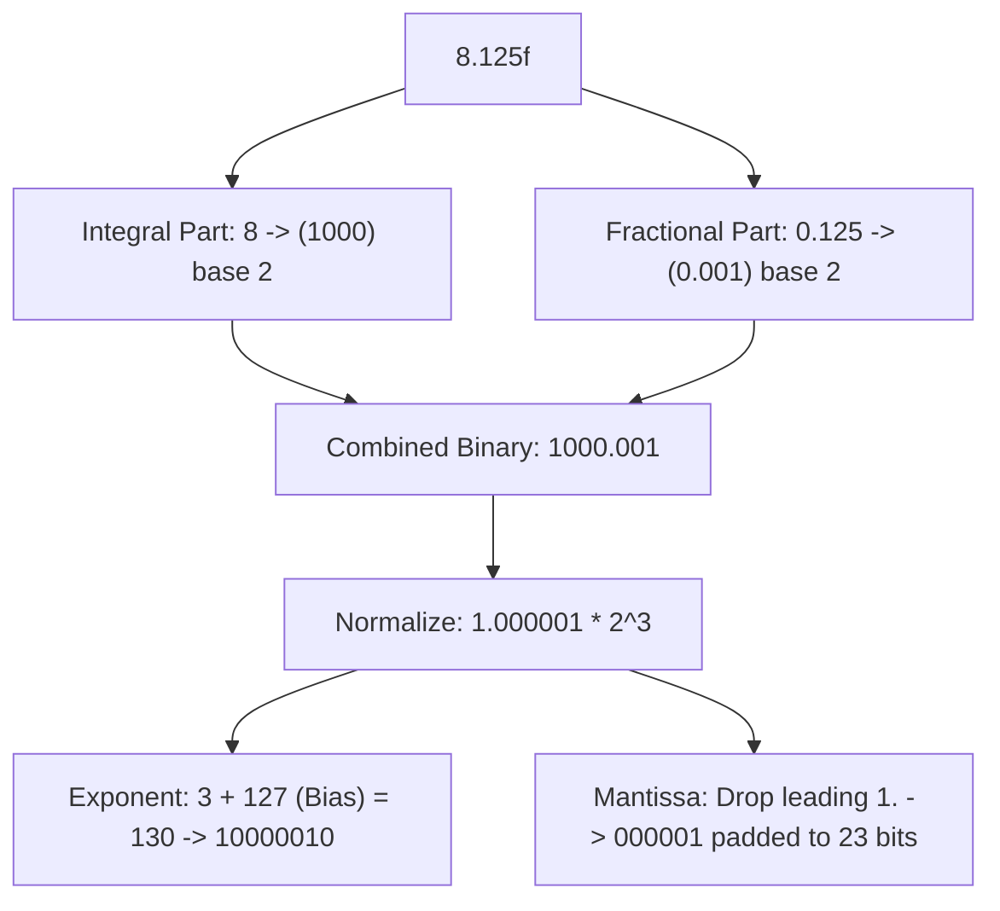

# Core Java — Lecture 04: Internal Binary Storage: Negative Numbers & IEEE 754 Floating-Point

---

## 📌 Mindmap



---

## 1. The Core Mystery: Floating-Point Precision Leak

When storing floating-point literals in Java, simple values sometimes do not store exactly:

```java
float f1 = 8.125f;
System.out.printf("%.20f\n", f1); // Output: 8.12500000000000000000 (Exact)

float f2 = 0.7f;
System.out.printf("%.20f\n", f2); // Output: 0.69999998807907104492 (Inexact / Approximation)
```

* `System.out.println(0.7f)` prints `0.7` because Java automatically rounds it for user display.
* Internally, computers only understand binary switches (0s and 1s). Certain decimal fractions create infinite repeating binary sequences that must be truncated by finite memory bits.

---

## 2. Storage of Negative Numbers: 2's Complement

Java represents all signed integers (`byte`, `short`, `int`, `long`) using **2's Complement notation**.



### Complete Walkthrough: Storing `-42` in `byte` (8-bit)
1. **Find Positive Binary (+42)**:
   * Repeatedly divide by 2 or evaluate binary powers ($32 + 8 + 2 = 42$):
     $$\text{+42 in 8 bits} = \mathbf{00101010}$$
2. **Find 1's Complement** (Invert every bit: $0 \to 1$, $1 \to 0$):
   $$\mathbf{11010101}$$
3. **Find 2's Complement** (Add binary 1 to 1's Complement):
   $$\begin{array}{r@{\quad}l}
     & 11010101 \\
   + & 00000001 \\
   \hline
   = & \mathbf{11010110}
   \end{array}$$
* Memory stores: `11010110` for `-42`.

---

## 3. MSB, LSB & Retrieval of Negative Numbers

* **MSB (Most Significant Bit)**: The leftmost bit. Carries the highest numerical weight ($2^{N-1}$). In signed integer types, it operates as the **Sign Bit**:
  * $\text{MSB} = 0 \implies \text{Positive Number}$
  * $\text{MSB} = 1 \implies \text{Negative Number}$
* **LSB (Least Significant Bit)**: The rightmost bit. Carries the smallest numerical weight ($2^0 = 1$).

### How the JVM Reads Back `11010110`:
1. Check MSB: It is `1`, meaning the number is **negative**.
2. Reverse 2's Complement to get magnitude:
   * Invert bits (1's complement of stored binary): $11010110 \to 00101001$.
   * Add 1: $00101001 + 1 = 00101010$ (which equals $42$ in decimal).
3. Append negative sign: Result is **$-42$**.

### Why 2's Complement? The "Case of Zero" ($+0$ vs. $-0$)
* In **1's Complement**, zero has two representations:
  * $+0 = 00000000$
  * $-0 = 11111111$ (Wasteful and complicates CPU arithmetic comparison circuits).
* In **2's Complement**, $-0$ automatically resolves to $+0$:
  * Start with $+0$: `00000000`
  * 1's Complement: `11111111`
  * Add 1: `11111111 + 1 = 100000000` (9 bits).
  * In an 8-bit container, the 9th carry bit overflows and is discarded, leaving **`00000000`**.
* Result: **Zero has exactly one unique binary representation.**

---

## 4. IEEE 754 Floating-Point Representation

Java adheres to the global **IEEE 754 Standard** for storing real/decimal numbers.



### Bit Layout Comparison:

| Data Type | Total Bits | Sign Bit | Exponent Bits | Mantissa (Fraction) Bits | Exponent Bias |
| :--- | :--- | :--- | :--- | :--- | :--- |
| **`float`** | 32 bits | 1 bit | 8 bits | 23 bits | $+127$ |
| **`double`** | 64 bits | 1 bit | 11 bits | 52 bits | $+1023$ |

### Mathematical Reconstruction Formula:
$$\text{Value} = (-1)^{\text{Sign}} \times (1 + \text{Mantissa}) \times 2^{(\text{Exponent} - \text{Bias})}$$

* **Sign**: $0$ for positive, $1$ for negative.
* **Normalized Mantissa**: Stored in the form $1.M$. The leading $1.$ is an **implicit/hidden bit** (not stored in memory, saving 1 bit of precision). Only the fractional part $M$ occupies the 23 (or 52) mantissa bits.
* **Bias Formula**:
  $$\text{Bias} = 2^{k-1} - 1 \quad (\text{where } k = \text{number of exponent bits})$$
  * For `float` ($k=8$): $\text{Bias} = 2^{8-1} - 1 = 2^7 - 1 = 127$.
  * For `double` ($k=11$): $\text{Bias} = 2^{11-1} - 1 = 2^{10} - 1 = 1023$.
* **Why Add Bias?** It shifts signed negative and positive exponents into an **unsigned positive integer range** ($0$ to $255$), enabling ultra-fast integer comparisons by CPU hardware without separate sign logic.

---

## 5. Walkthrough: Exact Storage Case (`8.125f`)



### Detailed Calculation:
1. **Convert to Raw Binary**:
   * Whole number $8 = 1000_2$
   * Fraction $0.125 \times 2 = 0.25$ (Carry $0$)
   * $0.25 \times 2 = 0.5$ (Carry $0$)
   * $0.5 \times 2 = 1.0$ (Carry $1$) $\implies 0.001_2$
   * Combined: $1000.001_2$
2. **Normalize into Scientific Form ($1.M \times 2^E$)**:
   * Shift point 3 positions to the left:
     $$1000.001_2 = \mathbf{1.000001_2 \times 2^3}$$
   * Raw Exponent $E = 3$.
3. **Compute Biased Exponent**:
   $$E_{\text{biased}} = 3 + 127 = 130 \implies \mathbf{10000010_2}$$
4. **Determine Mantissa ($23$ bits)**:
   * Drop the implicit leading $1.$: remaining part is `000001`.
   * Pad with zeros to 23 bits:
     $$\mathbf{00000100000000000000000}$$
5. **Final 32-bit Memory Layout**:
   $$\underbrace{0}_{\text{Sign (1)}} \quad \underbrace{10000010}_{\text{Exponent (8)}} \quad \underbrace{00000100000000000000000}_{\text{Mantissa (23)}}$$

---

## 6. Walkthrough: Inexact Storage Case (`0.7f`)

Why does `0.7f` turn into `0.699999988...`?

### The Infinite Binary Loop:
1. Fractional expansion by repeated multiplication by 2:
   $$\begin{array}{rcll}
   0.7 \times 2 & = & 1.4 & (\text{bit } 1) \\
   0.4 \times 2 & = & 0.8 & (\text{bit } 0) \\
   0.8 \times 2 & = & 1.6 & (\text{bit } 1) \\
   0.6 \times 2 & = & 1.2 & (\text{bit } 1) \\
   0.2 \times 2 & = & 0.4 & (\text{bit } 0) \quad \text{<-- Sequence repeats here} \\
   0.4 \times 2 & = & 0.8 & (\text{bit } 0) \\
   0.8 \times 2 & = & 1.6 & (\text{bit } 1) \\
   0.6 \times 2 & = & 1.2 & (\text{bit } 1)
   \end{array}$$
   $$\text{Binary of } 0.7 = 0.10110011001100110011\ldots \text{ (repeats indefinitely)}$$
2. **Normalize**:
   $$1.0110011001100110011001100\ldots \times 2^{-1}$$
3. **Biased Exponent**:
   $$E_{\text{biased}} = -1 + 127 = 126 \implies \mathbf{01111110_2}$$
4. **Mantissa Truncation**:
   * Hardware only has **23 bits** available for mantissa.
   * The infinite stream must be cut off at bit 23:
     $$\mathbf{01100110011001100110011}$$
5. **Reconstruction**:
   * When decoding back to decimal, the truncated fractional sum yields:
     $$(-1)^0 \times (1 + \text{fraction}) \times 2^{-1} \approx \mathbf{0.69999998807907104492}$$
   * Because infinite information was squeezed into 23 bits, precision was lost permanently.

---

## 7. Double Precision (64-bit IEEE 754)

`double` uses the exact same algorithm but expands precision significantly:
* **Sign**: 1 bit (Bit 63)
* **Exponent**: 11 bits (Bits 62–52), $\text{Bias} = 1023$
* **Mantissa**: 52 bits (Bits 51–0), yielding $\approx 15 - 17$ decimal digits of precision
* While double significantly delays rounding errors compared to float, **recurring fractions (like $0.7$ or $0.1$) still cannot be stored with 100% mathematical precision**.

---

## 8. 🎯 College Exam & Interview Boosters (Crucial Edge)

### Booster 1: Why Financial Code Never Uses `float` or `double`
In financial, banking, and e-commerce applications, accumulating tiny rounding discrepancies ($0.6999999...$) leads to major compounding balance errors.
* **Industry Standard**: Always use **`java.math.BigDecimal`**:
  ```java
  import java.math.BigDecimal;

  BigDecimal exact1 = new BigDecimal("0.7"); // Pass as String to prevent float rounding
  BigDecimal exact2 = new BigDecimal("0.1");
  BigDecimal sum = exact1.add(exact2); // Exactly 0.8
  ```

### Booster 2: Special Floating-Point Values (IEEE 754 Edge Cases)
The IEEE 754 standard defines special bit combinations for undefined operations:
1. **Positive / Negative Infinity**:
   ```java
   System.out.println(10.0 / 0.0);  // Prints: Infinity (Does NOT throw ArithmeticException!)
   System.out.println(-10.0 / 0.0); // Prints: -Infinity
   ```
2. **NaN (Not a Number)**:
   ```java
   System.out.println(0.0 / 0.0);        // Prints: NaN
   System.out.println(Math.sqrt(-4.0));   // Prints: NaN
   System.out.println(Float.NaN == Float.NaN); // Prints: false! (NaN is never equal to itself)
   ```

### Booster 3: The `strictfp` Keyword
* By default, modern JVMs may perform floating-point calculations using extended hardware precision (e.g., 80-bit x87 CPU registers), producing slightly different results between an Intel chip and an ARM chip.
* Marking a class or method with `strictfp` forces the JVM to strictly follow 32-bit and 64-bit IEEE 754 boundaries across all hardware platforms for reproducible floating-point calculations. *(Note: Since Java 17, IEEE 754 strict semantics are universally enabled by default, making `strictfp` redundant).*

### Booster 4: Quick Summary Table for Exams

| Parameter | 2's Complement Integers | IEEE 754 `float` | IEEE 754 `double` |
| :--- | :--- | :--- | :--- |
| **Bit Width** | 8 (`byte`), 16 (`short`), 32 (`int`), 64 (`long`) | 32 bits | 64 bits |
| **Sign Handling** | MSB (0 = Pos, 1 = Neg) | 1 dedicated bit | 1 dedicated bit |
| **Fraction Storage**| Integer-only (no fraction) | 23-bit Mantissa (implicit leading 1) | 52-bit Mantissa (implicit leading 1) |
| **Exponent Bias** | N/A | $+127$ | $+1023$ |
| **Exactness** | 100% mathematically exact | Approximates recurring fractions | Approximates recurring fractions |
| **Enterprise Fallback**| `BigInteger` (for $>64$-bit integers) | `BigDecimal` (for currency / exact math) | `BigDecimal` (for currency / exact math) |
