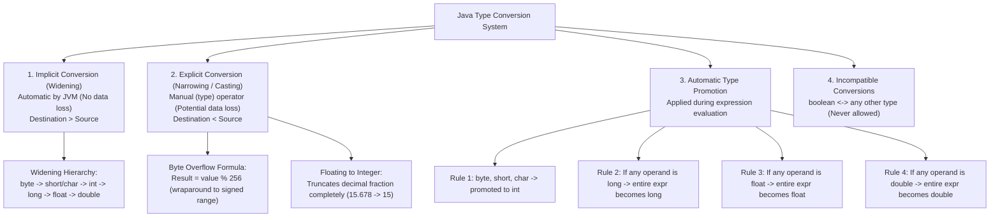
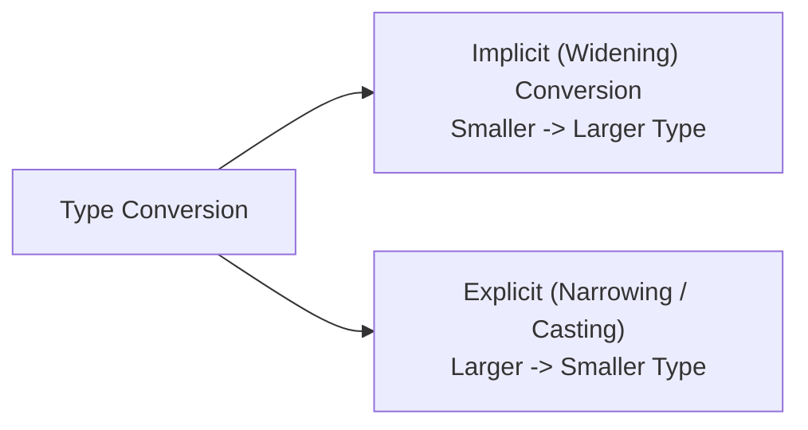
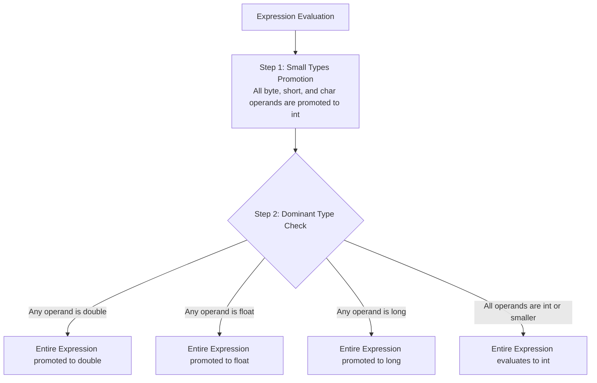

# Core Java — Lecture 05: Type Conversion, Type Casting & Automatic Type Promotion

---

## 📌 Mindmap



---

## 1. Classification of Type Conversion

Type conversion is the process of translating a value from one data type to another.



* **Implicit Conversion (Widening)**: Handled automatically by the Java compiler because the destination type is larger and can accommodate all possible values of the source type without data loss.
* **Explicit Conversion (Narrowing / Casting)**: Must be explicitly coded by the developer using the cast operator `(type)`. Required because the destination type is smaller, risking truncation or overflow.

---

## 2. Implicit Conversion (Widening Conversion)

### Golden Rule for Widening:
$$\text{Destination Data Type Size / Range} \ge \text{Source Data Type Size / Range}$$

### Widening Order (Automatic):
$$\mathbf{byte} \longrightarrow \mathbf{short} \longrightarrow \mathbf{int} \longrightarrow \mathbf{long} \longrightarrow \mathbf{float} \longrightarrow \mathbf{double}$$
$$\mathbf{char} \longrightarrow \mathbf{int}$$

### Examples:
```java
byte b = 24;
int i = b; // Valid implicit conversion (8-bit byte -> 32-bit int)

char c = 'a';
int asciiVal = c; // Valid implicit conversion (16-bit char -> 32-bit int, outputs 97)
```

---

## 3. Explicit Conversion (Narrowing & Casting)

When assigning a wider type to a narrower type, the compiler issues a `Type mismatch: cannot convert from X to Y` compile-time error. Developers must explicitly enforce casting:

$$\text{destinationVariable} = (\text{targetType})\ \text{sourceExpression};$$

```java
int i = 300;
// byte b = i; // COMPILE ERROR!
byte b = (byte) i; // Explicit Cast: compiles, but causes data loss
```

### The Math Behind Casting: Why `(byte) 300` Becomes `44`

An 8-bit `byte` can only retain the **lowest 8 bits (LSB)** of a 32-bit `int`.

#### Binary Truncation Method:
* 32-bit binary of $300$:
  $$\mathbf{00000000\ 00000000\ 00000001\ 00101100}$$
* Keeping only the lowest 8 bits:
  $$\mathbf{00101100}$$
* Evaluating the 8 bits:
  $$32 + 8 + 4 = \mathbf{44}$$

#### Modulo Shortcut Method:
$$\text{Result} = \text{Value} \pmod{\text{Range Size}}$$
* Range of `byte` has $2^8 = 256$ distinct states.
* $300 \pmod{256} = \mathbf{44}$.
* If the result exceeds $+127$, it wraps into negative values via 2's complement:
  $$\text{If } \text{Result} > 127 \implies \text{Result} - 256$$

---

## 4. Truncating Conversion (Floating Point to Integer)

When casting from `float` or `double` to an integer type (`byte`, `short`, `char`, `int`, `long`), Java **truncates the fractional part completely** (it does not round):

```java
float f = 15.678f;
int i = (int) f; // i becomes 15 (0.678 is discarded)
```

---

## 5. The Incompatible Type: `boolean`

In Java, **`boolean` is completely isolated from all numeric types**:
* `boolean` holds strictly `true` or `false`.
* `boolean` cannot be converted to `int`, `byte`, `char`, etc. (neither implicitly nor explicitly).
* `(int) true` or `(boolean) 1` will both throw a compile-time error.

---

## 6. Automatic Type Promotion in Expressions

When evaluating arithmetic expressions, Java automatically promotes operand data types according to strict rules to prevent immediate intermediate overflows:



### The 4 Type Promotion Rules:
1. **Rule 1 (Small Types Promotion)**: All `byte`, `short`, and `char` values are automatically promoted to `int` when used in arithmetic operations.
2. **Rule 2 (Long Dominance)**: If any operand in the expression is `long`, the entire expression is promoted to `long`.
3. **Rule 3 (Float Dominance)**: If any operand is `float`, the entire expression is promoted to `float`.
4. **Rule 4 (Double Dominance)**: If any operand is `double`, the entire expression is promoted to `double`.

---

## 7. The Classic Type Promotion Trap

Consider the following snippet:
```java
byte b = 50;
// b = b * 2; // COMPILE ERROR: Type mismatch: cannot convert from int to byte
```

### Why does this error occur?
1. In the expression `b * 2`, the operand `b` is a `byte`.
2. By **Rule 1**, `b` is automatically promoted to `int` before multiplication.
3. The result of `int * int` is an `int` value ($100$).
4. Attempting to assign an `int` back to a `byte` variable is a narrowing conversion that requires explicit casting:

```java
byte b = 50;
b = (byte)(b * 2); // Correct: Explicit cast applied to the entire evaluated expression
```

---

## 8. Comprehensive Expression Trace

Trace the evaluated type of each intermediate step:

```java
byte b = 42;
char c = 'a';     // Unicode value 97
short s = 1024;
int i = 50000;
float f = 5.67f;
double d = 0.1234;

double result = (f * b) + (i / c) - (d * s);
```

### Sub-expression Breakdown:
1. `(f * b)`: `float * byte` $\implies$ `b` promotes to `float`. Result is **`float`**.
2. `(i / c)`: `int / char` $\implies$ `c` promotes to `int` ($97$). Result is **`int`**.
3. `(d * s)`: `double * short` $\implies$ `s` promotes to `double`. Result is **`double`**.
4. `(float) + (int)`: `int` promotes to `float`. Intermediate sum is **`float`**.
5. `(float) - (double)`: `float` promotes to `double`. Final result is **`double`**.

---

## 9. 🎯 College Exam & Interview Boosters (Crucial Edge)

### Booster 1: Compound Assignment Operators & Hidden Casting
Why does `b = b + 1` fail to compile, but `b += 1` or `b++` compiles cleanly?

```java
byte b = 10;
// b = b + 1; // COMPILE ERROR: (b + 1) promotes to int!
b += 1;       // COMPILES CLEANLY!
b++;          // COMPILES CLEANLY!
```
* **Explanation**: Java's compound assignment operators (`+=`, `-=`, `*=`, `/=`) and increment/decrement operators (`++`, `--`) **internally inject an implicit cast**:
  $$E_1\ \text{op}=\ E_2 \iff E_1 = (T)(E_1\ \text{op}\ E_2) \quad (\text{where } T \text{ is the type of } E_1)$$
  `b += 1` is secretly compiled as `b = (byte)(b + 1)`.

### Booster 2: Negative Overflow in Narrowing Cast
What is the output of `(byte) 130`?
```java
int val = 130;
byte b = (byte) val;
System.out.println(b); // Output: -126
```
* **Why?**
  * $130$ in binary: `00000000 00000000 00000000 10000010`.
  * Truncated to 8 bits: `10000010`.
  * The MSB is `1` (negative number in 2's complement).
  * 2's complement reversal: Invert bits (`01111101`) + 1 (`01111110` $= 126_{10}$) $\implies \mathbf{-126}$.
  * Formula: $130 - 256 = \mathbf{-126}$.

### Booster 3: Character to Short Cast (Both are 16-bit!)
Why does `short s = c;` fail even though both `char` and `short` are 16 bits (2 bytes)?
```java
char c = 'A';
// short s = c; // COMPILE ERROR!
short s = (short) c; // Explicit cast required
```
* **Reason**:
  * `char` is **unsigned** ($0$ to $65,535$).
  * `short` is **signed** ($-32,768$ to $+32,767$).
  * A `char` value like $60,000$ cannot fit into a positive `short`. Because their ranges conflict, conversion in either direction requires explicit casting.

### Booster 4: Integer Division vs. Floating Point Division
```java
int a = 5;
int b = 2;

double res1 = a / b;         // Output: 2.0 (Integer division happens first: 5/2 = 2, then promoted to 2.0)
double res2 = (double) a / b; // Output: 2.5 (a is cast to double 5.0, so 5.0 / 2 = 2.5)
```
* **Rule**: In `a / b`, both operands are integers, so integer division truncates fractions before assignment.

### Booster 5: Summary Matrix for College Exams

| Conversion Type | From $\to$ To | Cast Required? | Data Loss Risk? | Mechanism |
| :--- | :--- | :--- | :--- | :--- |
| **Widening** | Smaller numeric $\to$ Larger numeric | No (Automatic) | No | Zero/Sign extension |
| **Narrowing** | Larger integer $\to$ Smaller integer | Yes `(type)` | Yes | Truncation of high-order bits |
| **Truncation**| Floating point $\to$ Integer | Yes `(type)` | Yes | Discarding fractional digits |
| **Char $\leftrightarrow$ Short** | `char` $\leftrightarrow$ `short` (Both 16-bit) | Yes `(type)` | Yes | Unsigned vs. Signed conflict |
| **Boolean** | `boolean` $\leftrightarrow$ Any other type | Impossible | N/A | Strictly forbidden by compiler |
