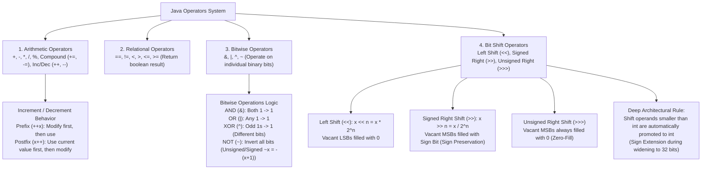
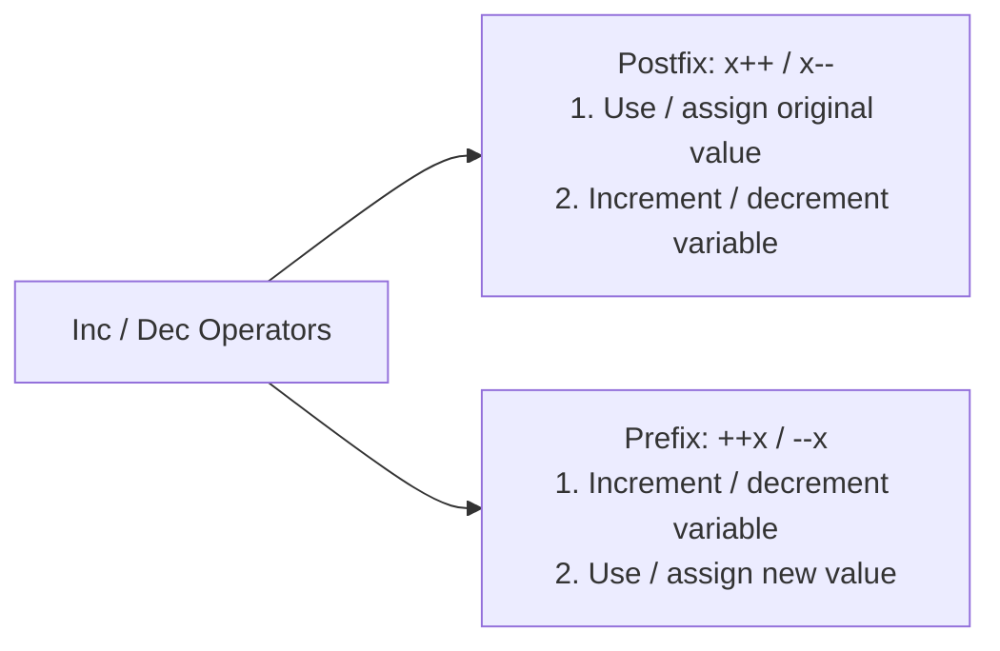
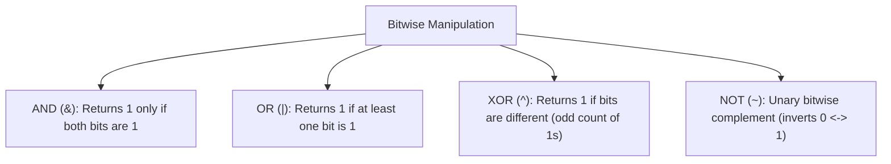
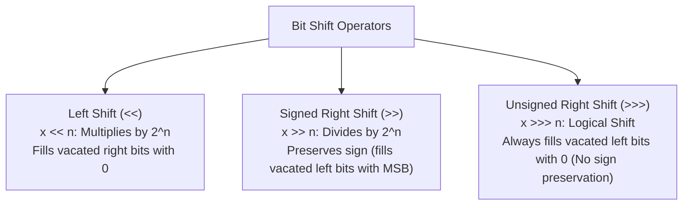
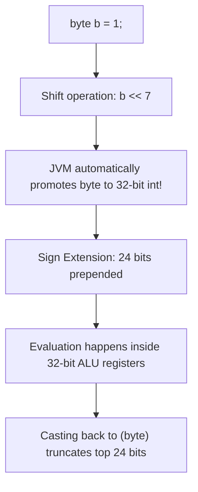

# Core Java — Lecture 06: Operators in Java (Arithmetic, Relational, Bitwise & Shift)

---

## 📌 Mindmap



---

## 1. Arithmetic Operators

Arithmetic operators perform basic mathematical calculations on numeric operands.

```java
int a = 5, b = 10;
int sum  = a + b; // 15
int diff = a - b; // -5
int prod = a * b; // 50
int div  = b / a; // 2 (Integer division truncates decimals)
int rem  = b % a; // 0 (Modulus operator returns remainder)
```

### Compound Assignment Operators (`+=`, `-=`, `*=`, `/=`, `%=`)
* Form: `a += b;` is shorthand for `a = (type)(a + b);`
* **Advantage**: Concise syntax, avoids repetition, and **injects implicit type casting** automatically.

---

## 2. Increment (`++`) & Decrement (`--`) Operators

These are **unary operators** used to adjust integer values by exactly 1.



### Detailed Trace:

```java
int j = 9;

// Postfix: Assign then increment
int k = j++; 
// Result: k = 9, j becomes 10

// Prefix: Increment then assign
int l = ++j; 
// Result: j becomes 11, l = 11
```

> [!NOTE]
> `j++` and `++j` alone on a single line produce the exact same result ($j$ increases by 1). The difference emerges **only when embedded within an expression or assignment**.

---

## 3. Relational Operators

Relational operators compare two operands and **always evaluate to a `boolean` result (`true` or `false`)**.

| Operator | Meaning | Example ($a=10, b=5$) | Result |
| :--- | :--- | :--- | :--- |
| `==` | Equal to | `a == b` | `false` |
| `!=` | Not equal to | `a != b` | `true` |
| `<` | Less than | `a < b` | `false` |
| `>` | Greater than | `a > b` | `true` |
| `<=` | Less than or equal to | `a <= b` | `false` |
| `>=` | Greater than or equal to| `a >= b` | `true` |

> [!WARNING]
> **Assignment vs Equality**:
> * `=` is the **Assignment Operator** (`a = 5` sets $a$ to 5).
> * `==` is the **Relational Comparison Operator** (`a == 5` tests if $a$ equals 5).

---

## 4. Bitwise Operators

Bitwise operators manipulate individual bits of integer data types at the hardware level.



### Truth Table:

| Bit A | Bit B | A & B (AND) | A \| B (OR) | A ^ B (XOR) | ~A (Bitwise Inversion) |
| :---: | :---: | :---: | :---: | :---: | :---: |
| 0 | 0 | 0 | 0 | 0 | 1 |
| 0 | 1 | 0 | 1 | 1 | 1 |
| 1 | 0 | 0 | 1 | 1 | 0 |
| 1 | 1 | 1 | 1 | 0 | 0 |

### Practical Bitwise Example:
```java
int a = 2; // 0010 in binary
int b = 3; // 0011 in binary

int andRes = a & b; // 0010 = 2
int orRes  = a | b; // 0011 = 3
int xorRes = a ^ b; // 0001 = 1
int notRes = ~a;    // Bitwise NOT: inverts all 32 bits -> evaluates to -3
```

---

## 5. Bit Shift Operators

Bit shift operators shift the entire binary bit sequence of a number left or right by $n$ positions.



### 1. Left Shift Operator (`<<`)
* Shifts all bits to the left by $n$ places.
* Vacant positions on the right (LSB) are filled with `0`.
* High-order bits that shift out of capacity are discarded.
* **Mathematical Formula**:
  $$\text{Result} = x \times 2^n$$

```java
int x = 8;        // ...00001000 (8)
int res = x << 1; // ...00010000 (16)
int res2 = x << 2;// ...00100000 (32)
```

### 2. Signed Right Shift Operator (`>>`)
* Shifts all bits to the right by $n$ places.
* High-order positions on the left (MSB) are filled with the **original Sign Bit** (preserving positive or negative sign).
* **Mathematical Formula**:
  $$\text{Result} = \lfloor x / 2^n \rfloor$$

```java
int x = 16;       // ...00010000 (16)
int res = x >> 1; // ...00001000 (8)
int neg = -16;
int negRes = neg >> 1; // Evaluates to -8 (Sign bit 1 is propagated)
```

### 3. Unsigned Right Shift Operator (`>>>`)
* Shifts all bits to the right by $n$ places.
* High-order vacant positions on the left are **always filled with `0`**, regardless of whether the original number was positive or negative.
* When applied to negative numbers, `>>>` turns them into large positive integers because the MSB becomes `0`.

```java
int neg = -1;       // 11111111 11111111 11111111 11111111
int res = neg >>> 1;// 01111111 11111111 11111111 11111111 = 2147483647 (Integer.MAX_VALUE)
```

---

## 6. The Deep Architectural Trap: Bit Shift & Type Promotion



### Why `(byte)(1 << 7)` Becomes `-128`
1. Operands of shift operators undergo **binary numeric promotion**: `byte` promotes to a 32-bit `int`.
2. Binary of $1$ in 32-bit:
   $$\mathbf{00000000\ 00000000\ 00000000\ 00000001}$$
3. Left shifting by 7 bits:
   $$\mathbf{00000000\ 00000000\ 00000000\ 10000000} \quad (\text{Value is } +128 \text{ in int})$$
4. Casting back to `byte` `(byte)(1 << 7)` takes only the lowest 8 bits:
   $$\mathbf{10000000}$$
5. In an 8-bit signed container, MSB is `1` $\implies$ 2's complement value is **$-128$**.

### Sign Extension during Promotion of Negative Values:
If `b = -128` (8-bit: `10000000`) is shifted, promotion to 32-bit `int` prepends 24 ones:
$$\mathbf{11111111\ 11111111\ 11111111\ 10000000}$$
Understanding that **JVM bitwise operations strictly occur in 32-bit (or 64-bit) registers** is essential for mastering Java systems internals.

---

## 7. 🎯 College Exam & Interview Boosters (Crucial Edge)

### Booster 1: The Fast Bitwise Formula for Bitwise NOT (`~`)
For any signed integer $x$:
$$\mathbf{\sim x = -(x + 1)}$$
* Example: $\sim 2 = -(2 + 1) = \mathbf{-3}$
* Example: $\sim (-5) = -(-5 + 1) = \mathbf{4}$

### Booster 2: XOR Swap Trick (Swap Without Temporary Variable)
```java
int a = 5, b = 9;
a = a ^ b;
b = a ^ b; // b becomes 5
a = a ^ b; // a becomes 9
```

### Booster 3: Modulo Arithmetic Shift Distance Masking
In Java, you cannot shift an `int` by 35 positions directly:
* For a 32-bit `int`, the JVM masks the shift distance using the lowest 5 bits:
  $$\text{Effective Shift Distance} = n \ \& \ 0x1F \quad (n \pmod{32})$$
  Therefore, `x << 32` is equivalent to `x << 0` (unchanged), and `x << 33` is equivalent to `x << 1`.
* For a 64-bit `long`, the JVM masks the shift distance with 6 bits:
  $$\text{Effective Shift Distance} = n \ \& \ 0x3F \quad (n \pmod{64})$$

### Booster 4: Power of 2 Check via Bitwise AND
To check if an integer $n > 0$ is a power of 2 in $O(1)$ time:
```java
boolean isPowerOfTwo = (n > 0) && ((n & (n - 1)) == 0);
```

### Booster 5: Bitwise Shift Operators vs Arithmetic Operators Summary

| Operator | Name | Effect | Sign Behavior | Vacated Bits Filled With |
| :--- | :--- | :--- | :--- | :--- |
| `<<` | Left Shift | $x \times 2^n$ | Preserves/Modifies based on overflow | Always `0` |
| `>>` | Signed Right Shift | $\lfloor x / 2^n \rfloor$ | **Preserves sign** | Original MSB (Sign Bit) |
| `>>>`| Unsigned Right Shift | Logical shift | **Destroys sign** (turns negative to large positive) | Always `0` |
