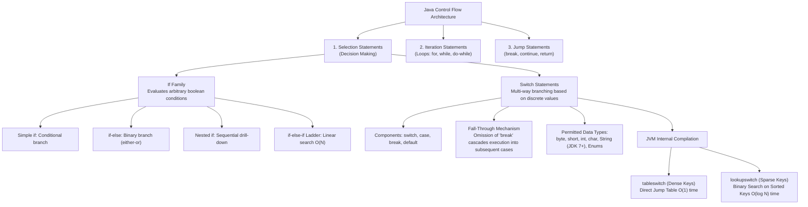
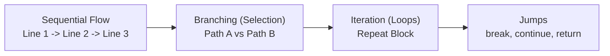
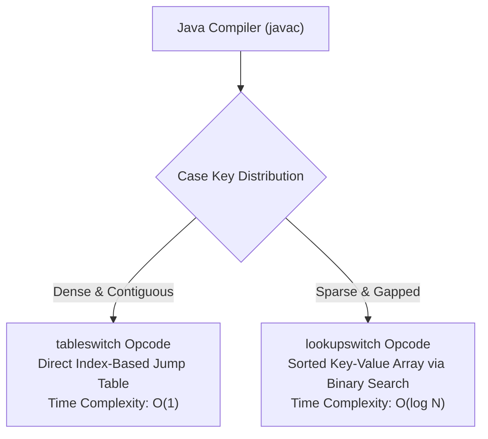

# Core Java — Lecture 07: Control Flow Statements (If-Else & Switch Deep Dive)

---

## 📌 Mindmap



---

## 1. Flow of Control: Foundational Concept

By default, the JVM executes statements sequentially (top-to-bottom, line-by-line). 
Control flow statements alter this linear execution path by introducing **branching**, **repetition**, or **abrupt jumps**.



---

## 2. Selection: The `if` Family

The `if` statement evaluates a condition that **must strictly resolve to a `boolean` value (`true` or `false`)**.

### A. Simple `if` & `if-else`
```java
if (score >= 40) {
    System.out.println("Pass");
} else {
    System.out.println("Fail");
}
```
* **Block Syntax Rule**: If an `if` or `else` branch contains only a single statement, curly braces `{}` are syntactically optional. However, industry and enterprise best practices mandate braces to prevent dangling statement bugs.

### B. Nested `if`
An `if` statement nested inside the body of an outer `if` or `else` block:
```java
if (num > 0) {
    if (num % 2 == 0) {
        System.out.println("Positive Even");
    } else {
        System.out.println("Positive Odd");
    }
}
```
> [!TIP]
> Keep nesting depth to $\le 2$ levels. Combine nested conditions using logical operators (`&&`, `||`) where possible to maximize readability.

### C. `if-else-if` Ladder
Used when evaluating multiple non-mutually exclusive conditions sequentially:
```java
if (age >= 80) {
    System.out.println("Very Old");
} else if (age >= 60) {
    System.out.println("Old");
} else if (age >= 40) {
    System.out.println("Middle Aged");
} else {
    System.out.println("Young");
}
```
* **Execution Rule**: Conditions are evaluated top-down. The moment **one** condition evaluates to `true`, its block executes and the **entire rest of the ladder is skipped**.
* **Time Complexity**: Worst-case $O(N)$ comparisons for $N$ conditions.

---

## 3. The `switch` Statement

The `switch` statement tests whether a variable or expression matches one of multiple constant discrete values.

```java
int day = 3;
switch (day) {
    case 1:
        System.out.println("Monday");
        break;
    case 2:
        System.out.println("Tuesday");
        break;
    case 3:
        System.out.println("Wednesday");
        break;
    default:
        System.out.println("Invalid Day");
        break;
}
```

### Components of `switch`:
1. **`switch (expression)`**: Evaluates an expression yielding a permitted data type.
2. **`case constant:`**: Value compared against the expression. Must be a compile-time constant or literal.
3. **`break;`**: Terminates the switch block and exits immediately.
4. **`default:`**: Optional fallback executed if no `case` matches. Equivalent to the trailing `else` in an `if-else-if` ladder.

---

## 4. The Fall-Through Phenomenon

If a `case` block does **not** terminate with a `break` statement, execution falls straight through into subsequent `case` blocks, executing their statements regardless of whether their condition matches:

```java
int val = 1;
switch (val) {
    case 1:
        System.out.print("1 ");
    case 2:
        System.out.print("2 ");
    case 3:
        System.out.print("3 ");
        break;
    default:
        System.out.print("Default ");
}
// Console Output: 1 2 3
```

### Why Fall-Through Exists by Design:
It enables grouping multiple matching inputs that share identical handling logic:
```java
char grade = 'B';
switch (grade) {
    case 'A':
    case 'B':
    case 'C':
        System.out.println("Satisfactory Completion");
        break;
    case 'D':
    case 'F':
        System.out.println("Action Required");
        break;
}
```

---

## 5. Permitted Switch Data Types

A switch expression can only evaluate to:
1. **Integer Primitives**: `byte`, `short`, `char`, `int` (and their respective wrapper classes: `Byte`, `Short`, `Character`, `Integer`).
2. **Enums** (`enum` types).
3. **`String`** *(Added in JDK 7)*.

> [!WARNING]
> **Strictly Disallowed in Switch**:
> * `long` (Too wide; 64-bit jump tables are architecturally prohibited by the JVM).
> * `float` & `double` (IEEE 754 precision inaccuracies make exact equality checks unreliable).
> * `boolean` (Use simple `if-else` instead).

---

## 6. JVM Deep Architecture: Why Switch is Faster Than If-Else



An `if-else-if` ladder always executes as a series of sequential conditional branch checks ($O(N)$ time). In contrast, the Java Virtual Machine compiles a `switch` statement into one of two specialized bytecode opcodes:

### 1. `tableswitch` (Dense / Consecutive Keys)
* Used when case values are tightly packed integers (e.g., `1, 2, 3, 4, 5`).
* **Mechanism**: The compiler constructs a **Direct Jump Table** in memory.
* **Execution**: The input key is mapped directly as an offset array index:
  $$\text{Target Address} = \text{BaseJumpAddress} + (\text{key} - \text{lowKey})$$
* **Performance**: Direct pointer lookup in **$O(1)$ constant time**, regardless of how many cases exist.

### 2. `lookupswitch` (Sparse / Dispersed Keys)
* Used when case values contain large gaps (e.g., `case 1:`, `case 500:`, `case 100000:`).
* Generating a contiguous array for sparse values would waste enormous amounts of memory on empty filler slots.
* **Mechanism**: The compiler produces a table of sorted keys paired with instruction offset addresses.
* **Execution**: The JVM executes a **binary search** over the sorted key array.
* **Performance**: Lookup runs in **$O(\log N)$ time**, which remains substantially faster than sequential `if-else` checks ($O(N)$) for large sets.

---

## 7. Direct Comparison: `if-else-if` vs `switch`

| Parameter | `if-else-if` Ladder | `switch` Statement |
| :--- | :--- | :--- |
| **Expression Evaluation** | Can evaluate ranges, inequalities (`<`, `>`, `<=`), complex logical conditions (`&&`, `||`) | Only tests discrete constant **equality** |
| **Permitted Types** | Any condition resolving to `boolean` | `byte`, `short`, `int`, `char`, `String`, Enums only |
| **Duplicate Keys** | Syntactically allowed (earlier branches shadow subsequent ones) | **Compile-time Error** (duplicate case labels forbidden) |
| **Underlying Bytecode** | Chains of conditional branch instructions (`if_icmpne`, `goto`) | Optimized `tableswitch` ($O(1)$) or `lookupswitch` ($O(\log N)$) |
| **Readability** | Messy for large multi-way value branches | Clean, readable, and structured |

---

## 8. 🎯 College Exam & Interview Boosters (Crucial Edge)

### Booster 1: Case Labels Must Be Compile-Time Constants
Every `case` label must be a **constant expression** or literal known at compile time:
```java
int x = 10;
int y = 20;

switch (x) {
    // case y: // COMPILE ERROR! y is a variable!
    case 20:   // Valid literal constant
        break;
}

final int CONST_Z = 30;
switch (x) {
    case CONST_Z: // COMPILES CLEANLY! Marked 'final' with compile-time constant value
        break;
}
```

### Booster 2: Duplicate Case Labels & Unreachable Code
Java enforces strict compile-time uniqueness on case values:
```java
switch (x) {
    case 1:
        break;
    // case 1: // COMPILE ERROR: Duplicate case label!
}
```
In an `if-else-if` ladder, writing identical conditions is legal syntax, though subsequent duplicates become dead/unreachable code.

### Booster 3: How `switch (String)` Works Internally (JDK 7+)
A `switch` on a `String` is internally compiled into a **two-step check by `javac`**:
1. First, it switches on the String's **`hashCode()`** using `lookupswitch`.
2. Because different strings can produce identical hash codes (hash collision), it verifies the match using **`.equals()`** before entering the target case body.

### Booster 4: Modern Java Switch Expressions (Java 14+)
Modern Java introduced arrow syntax (`->`) that eliminates fall-through and allows switch to operate as an expression returning a value:
```java
int day = 2;
String dayName = switch (day) {
    case 1 -> "Monday";
    case 2 -> "Tuesday";
    default -> "Invalid";
}; // Notice trailing semicolon
```

### Booster 5: Position of the `default` Case
The `default` block does **not** have to be at the very bottom. It can appear anywhere inside the switch body. However, if placed in the middle without a `break`, it will fall through into whatever case label follows it!
