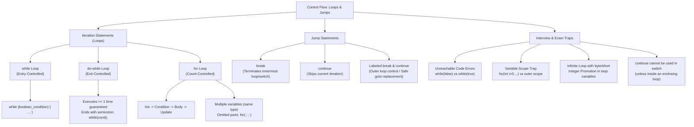
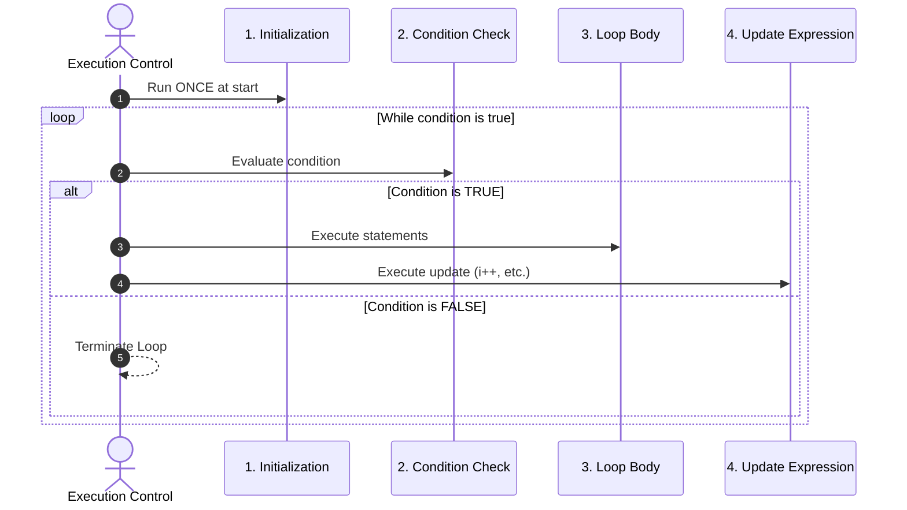

# Core Java: Lecture 08 — Iteration & Jump Statements



---

## 1. Introduction to Iteration Statements (Loops)

In Java, **Iteration Statements** (commonly called **Loops**) repeatedly execute a block of code as long as a specified boolean condition evaluates to `true`.

Java provides three primary loop constructs:
1. `while` loop (Entry-Controlled)
2. `do-while` loop (Exit-Controlled)
3. `for` loop (Count/Condition-Controlled)

```
        +----------------------------------------------------+
        |                    LOOP TYPES                      |
        +-------------------------+--------------------------+
        | Entry-Controlled Loops  |  Exit-Controlled Loops   |
        +-------------------------+--------------------------+
        | Condition tested BEFORE | Condition tested AFTER   |
        | body executes.          | body executes.           |
        | Min executions: 0       | Min executions: 1        |
        | Examples: while, for    | Examples: do-while       |
        +-------------------------+--------------------------+
```

---

## 2. The `while` Loop (Entry-Controlled)

The `while` loop repeatedly executes its statement block as long as its controlling expression remains `true`.

### Syntax
```java
while (boolean_condition) {
    // Loop body
    // Update expression (optional inside body)
}
```

### Execution Flow
1. **Condition Evaluation:** The condition expression is evaluated. It **must** evaluate to a primitive `boolean` or `Boolean` wrapper (compile-time error otherwise).
2. **Body Execution:** If `true`, the body executes. If `false`, execution skips immediately past the loop.
3. **Loopback:** Once the body finishes, control jumps back to Step 1.

```java
int count = 1;
while (count <= 5) {
    System.out.println("Iteration: " + count);
    count++; // Update expression
}
```

### Critical Pitfalls
- **Accidental Semicolon:**
  ```java
  int i = 0;
  while (i < 5); // Empty statement executed infinitely!
  {
      i++; // Unreachable / Never executed inside loop
  }
  ```
- **Unreachable Code Compile Error:**
  ```java
  while (false) {
      System.out.println("Hello"); // COMPILE ERROR: unreachable statement
  }
  ```

---

## 3. The `do-while` Loop (Exit-Controlled)

The `do-while` loop evaluates its conditional expression **at the end** of the loop body.

### Syntax
```java
do {
    // Loop body
    // Update expression
} while (boolean_condition); // NOTE: Semicolon is mandatory here!
```

### Key Properties
- **Guaranteed Single Execution:** Because the condition check happens after body execution, the body is guaranteed to run **at least once**, even if the condition is initially `false`.
- **Primary Use Cases:**
  - Interactive console menus (displaying menu options at least once).
  - Validating user input (read input first, then repeat if invalid).

```java
int choice;
Scanner sc = new Scanner(System.in);
do {
    System.out.println("1. Start Game");
    System.out.println("2. Options");
    System.out.println("3. Exit");
    choice = sc.nextInt();
} while (choice != 3);
```

---

## 4. The `for` Loop (Count / Iteration-Controlled)

The `for` loop provides a compact, structured syntax combining initialization, condition testing, and update operations in a single header line.

### Syntax
```java
for (initialization; boolean_condition; update_expression) {
    // Loop body
}
```

### Execution Order & Lifecycle


1. **Initialization:** Runs **exactly once** when the loop begins.
2. **Condition:** Evaluated before every iteration. If `false`, the loop terminates.
3. **Body:** Runs if the condition was `true`.
4. **Update:** Runs **after** the body finishes, immediately before returning to evaluate the condition again.

---

## 5. Advanced Variations of `for` Loops

### 5.1 Multiple Initializers and Multiple Updates
Java allows declaring multiple variables in the initialization part, provided they share the **same data type**:

```java
// VALID: Multiple variables of the SAME type
for (int i = 1, j = 10; i <= j; i++, j -= 2) {
    System.out.println("i=" + i + ", j=" + j);
}
```

> [!WARNING]
> Different data types in a single `for` loop header initialization are **illegal**:
> ```java
> for (int i = 0, double d = 0.5; i < 5; i++) { } // COMPILE ERROR!
> ```

### 5.2 Omitted Components & Infinite Loops
Every section of the `for` loop header is optional:

```java
// 1. Omitted Initialization (pre-initialized)
int i = 0;
for (; i < 5; i++) { ... }

// 2. Omitted Update (updated inside body)
for (int k = 0; k < 5; ) {
    k++;
}

// 3. Infinite for loop (Standard Idiom)
for (;;) {
    // Equivalent to while(true)
    // The omitted condition defaults to true in Java bytecode!
}
```

---

## 6. Loop Scope & Bytecode Type Traps

### 6.1 The Scope Leak Trap
Variables declared inside the `for` header exist **only within that loop's scope**:

```java
for (int i = 0; i < 5; i++) {
    // i is accessible here
}
System.out.println(i); // COMPILE ERROR: cannot find symbol variable i
```
To inspect the final value after termination, declare the variable prior to the loop:
```java
int i;
for (i = 0; i < 5; i++) { ... }
System.out.println("Terminated at i = " + i); // Valid: prints 5
```

### 6.2 Why Do Loops Default to `int` Instead of `byte` or `short`?

1. **Bytecode Instruction Set Design:**
   The JVM bytecode instruction set does not have dedicated arithmetic instructions for 8-bit (`byte`) or 16-bit (`short`) operations. The JVM automatically widens `byte` and `short` to 32-bit `int` on the operand stack during arithmetic operations.
2. **Infinite Loop Overflow Hazard:**
   Using `byte` as a loop counter can lead to infinite overflow loops:
   ```java
   // DANGEROUS / INFINITE LOOP:
   for (byte b = 0; b <= 127; b++) {
       System.out.println(b);
       // When b reaches 127, (b + 1) overflows to -128.
       // b <= 127 is ALWAYS true! The loop will never terminate!
   }
   ```

---

## 7. Nested Loops & Time Complexity

A loop placed inside the body of another loop is called a **Nested Loop**.
- For each single iteration of the **outer loop**, the **inner loop** executes through all its iterations.

### Visual Model (Grid / Pattern Generation)
```java
int rows = 3;
int cols = 4;

for (int r = 1; r <= rows; r++) {        // Outer loop (controls rows)
    for (int c = 1; c <= cols; c++) {    // Inner loop (controls columns)
        System.out.print("* ");
    }
    System.out.println();                // Line break after each row completes
}
```

**Output:**
```
* * * *
* * * *
* * * *
```

### Time Complexity
- If the outer loop runs $N$ times and the inner loop runs $M$ times:
  $$\text{Total Iterations} = N \times M \implies \mathcal{O}(N \times M)$$
- If both loops run $N$ times:
  $$\text{Total Iterations} = N^2 \implies \mathcal{O}(N^2)$$

---

## 8. Jump Statements: `break`, `continue`, and Labels

Java supports three jump statements: `break`, `continue`, and `return` (covered in methods).

### 8.1 The `break` Statement
- **Purpose:** Immediately terminates the enclosing loop (`for`, `while`, `do-while`) or `switch` block.
- **Execution:** Control jumps directly to the first statement following the enclosing block.

```java
// Finding if a number is prime using early exit
int n = 29;
boolean isPrime = true;

for (int i = 2; i * i <= n; i++) {
    if (n % i == 0) {
        isPrime = false;
        break; // No need to test further factors; exit loop immediately
    }
}
```

### 8.2 The `continue` Statement
- **Purpose:** Stops the current iteration of the enclosing loop and immediately begins the **next** iteration.
- **Differences across loop types:**
  - **In `for` loops:** Control jumps directly to the **update expression** (`i++`), then evaluates the condition.
  - **In `while` / `do-while` loops:** Control jumps directly to the **conditional expression**.

```java
// Print only odd numbers from 1 to 10
for (int i = 1; i <= 10; i++) {
    if (i % 2 == 0) {
        continue; // Skip even numbers, jump directly to i++
    }
    System.out.print(i + " "); // Prints: 1 3 5 7 9
}
```

> [!CAUTION]
> **Infinite Loop Trap with `continue` in `while` loops:**
> ```java
> int i = 1;
> while (i <= 5) {
>     if (i == 3) {
>         continue; // BUG: skips i++, meaning i remains 3 forever!
>     }
>     System.out.println(i);
>     i++;
> }
> ```

---

## 9. Labeled `break` and Labeled `continue`

In nested loops, an unlabeled `break` or `continue` only affects the **innermost** loop. To manipulate an outer loop from deep inside nested loops, Java provides **Labeled Statements** (a safe, structured replacement for `goto`).

### Syntax
```java
outerLoop:
for (int i = 1; i <= 3; i++) {
    innerLoop:
    for (int j = 1; j <= 3; j++) {
        if (i == 2 && j == 2) {
            break outerLoop; // Terminates the OUTER loop entirely!
        }
        System.out.println("i=" + i + ", j=" + j);
    }
}
```

### Labeled `continue`
```java
rowScan:
for (int r = 0; r < 5; r++) {
    for (int c = 0; c < 5; c++) {
        if (matrix[r][c] == -1) {
            // Bad row entry; abandon rest of this row and jump to next row
            continue rowScan;
        }
        process(matrix[r][c]);
    }
}
```

---

## 10. College Exam & Technical Interview Boosters

### 1. `while(true)` vs `for(;;)` at Bytecode Level
- In Java, both `while(true)` and `for(;;)` compile to identical bytecode: an unconditional `goto` instruction.
- However, `for(;;)` has no condition in its source AST, whereas `while(true)` has a constant boolean literal `true`. Both are treated as infinite loops by the compiler's definite assignment and reachability analyzer.

### 2. Definite Reachability & Compiler Traps
```java
// Case A: Compile Error
while (false) {
    int a = 10; // COMPILE ERROR: unreachable statement
}

// Case B: Valid compilation! (Constant expression vs variable)
boolean flag = false;
while (flag) {
    int a = 10; // COMPILES FINE! Compiler does not treat non-final variables as constants
}

// Case C: Compile Error with final variable
final boolean FINAL_FLAG = false;
while (FINAL_FLAG) {
    int a = 10; // COMPILE ERROR: unreachable statement
}
```

### 3. `continue` is Illegal in Plain `switch`
- `break` is legal inside both loops and `switch`.
- `continue` is **only** legal inside loops. You cannot use `continue` inside a `switch` statement unless that `switch` is physically enclosed inside a loop!

```java
int val = 2;
switch (val) {
    case 1:
        System.out.println("One");
        break;
    case 2:
        continue; // COMPILE ERROR: continue outside of loop
}
```

### 4. Comparison Summary Table

| Feature | `while` Loop | `do-while` Loop | `for` Loop |
| :--- | :--- | :--- | :--- |
| **Control Type** | Entry-controlled | Exit-controlled | Entry-controlled |
| **Minimum Iterations** | `0` | `1` | `0` |
| **Trailing Semicolon** | No (`while (cond) { }`) | **Yes (`while (cond);`)** | No |
| **Ideal Scenario** | Unknown number of iterations, dependent on condition | Menus, at least one prompt required | Known number of iterations / indexed traversals |
| **Variable Scope** | External | External | Loop-local (if declared in header) |
