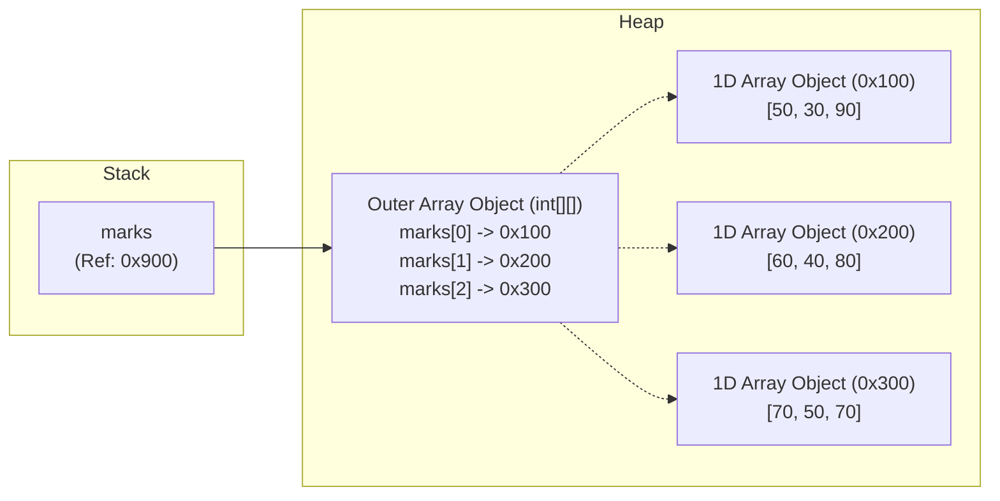

# Core Java: Lecture 09 — Arrays (1D, 2D, Jagged & Multi-Dimensional)

```mermaid
flowchart TD
    Root["Java Arrays"] --> Core["Array Fundamentals"]
    Root --> Memory["Memory Architecture"]
    Root --> MultiD["Multi-Dimensional & Jagged"]
    Root --> Traps["Interview & Exam Boosters"]

    Core --> Def["Declaration & Instantiation<br/>int[] arr = new int[N];"]
    Core --> Indexing["0-Based Indexing<br/>Valid: 0 to (length - 1)"]
    Core --> Prop["Array Property<br/>arr.length (Field, not method)"]
    Core --> Exception1["Exception<br/>ArrayIndexOutOfBoundsException"]

    Memory --> StackHeap["Stack vs Heap<br/>Reference on Stack, Object on Heap"]
    Memory --> Contiguous["Contiguous Storage<br/>Elements placed sequentially"]
    Memory --> Defaults["Default Values<br/>int: 0, double: 0.0, boolean: false, Object: null"]

    MultiD --> Concept["Array of Arrays<br/>Java does not have true C-style flat 2D arrays"]
    MultiD --> Conceptual["Conceptual: Matrix (Rows x Cols)"]
    MultiD --> Logical["Logical: Reference Array pointing to Sub-Arrays"]
    MultiD --> Jagged["Jagged Arrays<br/>new int[3][] -> variable row lengths"]

    Traps --> LengthTrap["length vs length() vs size()"]
    Traps --> NegSize["NegativeArraySizeException vs Size 0"]
    Traps --> DeclSyntax["int[] a, b vs int a[], b"]
    Traps --> ImmType["Array Covariance & Identity"]
```



---

## 1. Why Arrays? (Motivation & Definition)

When developing applications, storing multiple related data items (e.g., marks of 100 students) using individual primitive variables (`int s1, s2, s3, ... s100;`) creates:
- Unmaintainable, repetitive boilerplate code.
- Inability to dynamically index, sort, or traverse elements in algorithms.

### Definition
An **Array** in Java is a dynamically created data structure (an **Object**) that stores a fixed-size, sequential collection of elements of the **same data type** in **contiguous memory locations**.

```
                +---+---+---+---+---+
    Indices:    | 0 | 1 | 2 | 3 | 4 |  <-- 0-based indexing
                +---+---+---+---+---+
    Values:     |10 |20 |30 |40 |50 |  <-- Homogeneous elements
                +---+---+---+---+---+
```

---

## 2. Array Declaration, Instantiation & Initialization

In Java, creating an array involves distinct stages: **Declaration**, **Instantiation**, and **Initialization**.

```mermaid
sequenceDiagram
    autonumber
    participant S as Stack Memory
    participant H as Heap Memory

    Note over S: 1. Declaration: int[] arr;
    S->>S: Creates reference variable 'arr' (null / uninitialized)
    Note over H: 2. Instantiation: new int[3];
    H->>H: Allocates contiguous block of 3 integers (3 x 4 bytes = 12 bytes)
    H->>H: Initializes each cell to default value (0)
    H-->>S: Returns starting heap memory address (e.g., 0x7A2F)
    Note over S,H: 3. Initialization: arr[0] = 101; arr[1] = 102; arr[2] = 103;
    S->>H: Updates values at calculated index offsets
```

### 2.1 Declaration Syntax
Tells the compiler the variable name and element type:

```java
int[] rollNumbers;  // Preferred Java standard
int rollNumbers[];  // Permitted for C/C++ legacy compatibility
```

> [!NOTE]
> During declaration, **never specify the size inside square brackets**:
> ```java
> int[5] arr; // COMPILE ERROR: illegal start of type
> ```

### 2.2 Instantiation (Allocation via `new`)
Allocates memory on the **Heap** using the `new` keyword:

```java
rollNumbers = new int[3]; // Allocates 3 contiguous 32-bit int cells
```

Combined declaration and instantiation:
```java
int[] rollNumbers = new int[3];
```

### 2.3 Multiple Variable Declaration Trap
Notice how square bracket placement affects variable types:
```java
int[] a, b;  // Both 'a' and 'b' are 1D arrays of int (int[])
int a[], b;  // 'a' is a 1D array of int (int[]), but 'b' is a regular int primitive!
int[] a[], b; // 'a' is a 2D array (int[][]), 'b' is a 1D array (int[])
```

### 2.4 Array Initialization Literals
```java
// Method A: Dynamic allocation + explicit assignment
int[] arr = new int[3];
arr[0] = 10; arr[1] = 20; arr[2] = 30;

// Method B: Array literal (Declaration & initialization together)
int[] arr = {10, 20, 30};

// Method C: Anonymous Array (Instantiation with inline values)
int[] arr = new int[]{10, 20, 30}; // Do NOT specify size inside brackets!
```

---

## 3. Memory Architecture: Stack vs. Heap

In Java, **arrays are always Objects**. They reside in the Heap, while their reference variables reside in the Stack (if declared locally).

```
   STACK MEMORY                         HEAP MEMORY
+------------------+         +-------------------------------+
|                  |         |  Array Object (int[3])        |
|  rollNumbers     |-------->|  [0]: 1001                    |
|  (Address: 0x1A) |         |  [1]: 1002                    |
|                  |         |  [2]: 1003                    |
|                  |         |  .length = 3 (final metadata) |
+------------------+         +-------------------------------+
```

### Default Initialization Values
When instantiated with `new`, Java automatically initializes every cell to its data type's default value:
- `byte`, `short`, `int`, `long` $\rightarrow$ `0`
- `float`, `double` $\rightarrow$ `0.0`
- `char` $\rightarrow$ `'\u0000'` (null character, integer value 0)
- `boolean` $\rightarrow$ `false`
- Reference types (Objects, Strings) $\rightarrow$ `null`

---

## 4. Indexing, Iteration & The `.length` Property

### 4.1 0-Based Indexing Mechanics
- Starting index: `0`
- Ending index: `arr.length - 1`
- **Offset Calculation Formula:**
  $$\text{Address of Element}(i) = \text{Base Address} + (i \times \text{Size of Data Type})$$
  Because the offset for the first element is $0 \times \text{Size} = 0$, indexing naturally begins at 0.

### 4.2 The `.length` Property
- `.length` is a **built-in `public final` instance field** automatically generated for every array object.
- It is **not a method** (unlike `String.length()`).
- Attempting to modify it (`arr.length = 10;`) results in a compile-time error (`cannot assign a value to final variable length`).

### 4.3 Iteration Patterns

#### Standard For Loop
```java
int[] rollNumbers = {1001, 1002, 1003};

for (int i = 0; i < rollNumbers.length; i++) {
    System.out.println("Index " + i + ": " + rollNumbers[i]);
}
```

#### Enhanced For Loop (For-Each)
Ideal for read-only forward traversals:
```java
for (int num : rollNumbers) {
    System.out.println(num);
}
```

---

## 5. `ArrayIndexOutOfBoundsException`

Thrown at **runtime** whenever an invalid index is accessed ($i < 0$ or $i \ge \text{arr.length}$).

```java
int[] arr = new int[3]; // Valid indices: 0, 1, 2

System.out.println(arr[3]);  // Throws ArrayIndexOutOfBoundsException: Index 3 out of bounds for length 3
System.out.println(arr[-1]); // Throws ArrayIndexOutOfBoundsException: Index -1 out of bounds for length 3
```

> [!IMPORTANT]
> In C/C++, accessing an out-of-bounds index leads to undefined behavior or silent memory corruption because boundary checks are omitted for raw speed.
> In Java, the JVM performs **strict runtime bounds checking** on every array access to guarantee security and memory safety.

---

## 6. Two-Dimensional (2D) Arrays: Conceptual vs. Logical Representation

### 6.1 Conceptual View: The Matrix
To human developers, a 2D array represents a table or matrix with rows ($R$) and columns ($C$):

```
       Col 0   Col 1   Col 2
Row 0 [ 50  ,   30  ,   90  ]
Row 1 [ 60  ,   40  ,   80  ]
Row 2 [ 70  ,   50  ,   70  ]
```

Declaration:
```java
int[][] marks = new int[3][3]; // 3 rows, 3 columns
```

### 6.2 Logical View: Array of Arrays
In Java, **true multi-dimensional arrays do not exist**.
Instead, a 2D array is an **array of references**, where each element points to another independent 1D array object on the Heap.



### 6.3 Traversal Using Dynamic Lengths
Because 2D arrays are arrays of arrays:
- `marks.length` returns the **number of rows** (outer array size).
- `marks[row].length` returns the **number of columns in that specific row**.

```java
int[][] marks = {
    {50, 30, 90},
    {60, 40, 80},
    {70, 50, 70}
};

for (int r = 0; r < marks.length; r++) {
    for (int c = 0; c < marks[r].length; c++) {
        System.out.print(marks[r][c] + "\t");
    }
    System.out.println(); // Next line after completing row
}
```

---

## 7. Jagged Arrays (Non-Rectangular Arrays)

Because every row in a 2D array is an independent array object, **rows do not need to have the same length**. An array with variable column sizes across rows is known as a **Jagged Array** (or Ragged Array).

### Declaration & Step-by-Step Allocation
```java
// Step 1: Allocate outer array (Row count is MANDATORY, Column count left empty)
int[][] jagged = new int[3][];

// Step 2: Allocate each row independently with customized sizes
jagged[0] = new int[2]; // Row 0 has 2 columns
jagged[1] = new int[4]; // Row 1 has 4 columns
jagged[2] = new int[3]; // Row 2 has 3 columns
```

```
Jagged Array Layout:
jagged[0] -> [ 0, 0 ]
jagged[1] -> [ 0, 0, 0, 0 ]
jagged[2] -> [ 0, 0, 0 ]
```

> [!WARNING]
> If you access `jagged[0][0]` before instantiating row 0 (`jagged[0] = new int[2];`), Java throws a `NullPointerException` because `jagged[0]` is initialized to `null`.

### Static Initialization of Jagged Arrays
```java
int[][] jagged = {
    {1, 2},
    {3, 4, 5, 6},
    {7, 8, 9}
};

for (int r = 0; r < jagged.length; r++) {
    for (int c = 0; c < jagged[r].length; c++) {
        System.out.print(jagged[r][c] + " ");
    }
    System.out.println();
}
```

---

## 8. Multi-Dimensional Arrays: 3D and Beyond

A 3D array in Java is simply an **array of 2D arrays** (an array of references pointing to arrays of references pointing to 1D arrays).

### Syntax
```java
int[][][] tensor = new int[2][3][4];
// Represents:
// 2 blocks/layers
// Each block contains 3 rows
// Each row contains 4 columns
```

### Deep Nested Traversal
```java
for (int i = 0; i < tensor.length; i++) {
    for (int j = 0; j < tensor[i].length; j++) {
        for (int k = 0; k < tensor[i][j].length; k++) {
            System.out.print(tensor[i][j][k] + " ");
        }
        System.out.println();
    }
    System.out.println("-----------------");
}
```

---

## 9. College Exam & Technical Interview Boosters

### 1. `length` vs `length()` vs `size()`
| Construct | Target Data Structure | Nature | Example |
| :--- | :--- | :--- | :--- |
| **`length`** | Arrays (`int[]`, `String[]`, etc.) | Final field/attribute | `arr.length` |
| **`length()`** | Strings (`java.lang.String`) | Method | `str.length()` |
| **`size()`** | Collections (`ArrayList`, `HashSet`, etc.) | Method | `list.size()` |

### 2. Zero-Length Arrays vs `null` Reference
```java
int[] empty = new int[0]; // VALID: creates an array object of length 0 in Heap
System.out.println(empty.length); // Prints: 0

int[] nullRef = null;    // Reference does not point to any Heap object
System.out.println(nullRef.length); // Throws NullPointerException!
```

### 3. Negative Array Sizes
```java
int[] bad = new int[-5]; // COMPILES FINE, but throws Runtime Exception:
                         // java.lang.NegativeArraySizeException: -5
```

### 4. Memory Copying: Shallow Copy vs Deep Copy
- Simply assigning references (`int[] b = a;`) copies the **memory address**, NOT the elements. Changes to `b[0]` affect `a[0]`.
- To create an independent copy:
  ```java
  int[] copy = a.clone();                   // Shallow copy of 1D array
  int[] copy2 = Arrays.copyOf(a, a.length); // Copies specified range
  ```
- For 2D / Jagged arrays, `.clone()` only duplicates the outer array of references (both point to the same sub-row arrays). Deep cloning requires manually copying each row.

### 5. Array Class Identity
Every array type has a synthetic class generated by the JVM:
```java
int[] a = new int[5];
System.out.println(a.getClass().getName()); // Prints: [I  ('[I' stands for 1D int array)

int[][] b = new int[2][2];
System.out.println(b.getClass().getName()); // Prints: [[I ('[[I' stands for 2D int array)

String[] c = new String[3];
System.out.println(c.getClass().getName()); // Prints: [Ljava.lang.String;
```
