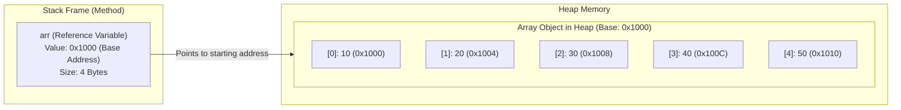
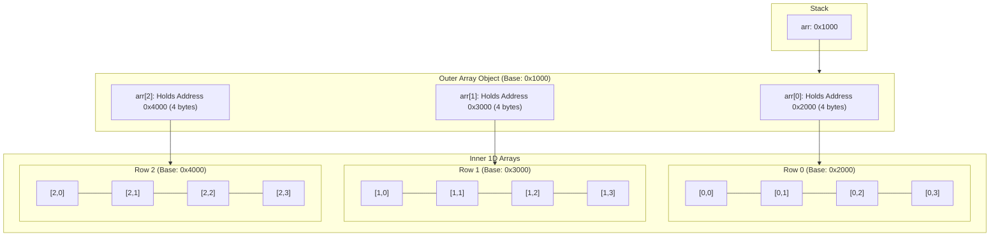

# Core Java: Lecture 10 — Array Memory Internals, Address Calculation & Hardware Cache Locality

```mermaid
flowchart TD
    Root["Array Memory & Addressing"] --> RandAccess["O(1) Random Access"]
    Root --> Formula["Address Calculation Formulas"]
    Root --> TypesMemory["Memory Layout by Type"]
    Root --> HardwareOpt["Hardware & Cache Locality"]
    Root --> InterviewTraps["Interview & Exam Boosters"]

    RandAccess --> ConstantTime["O(1) Direct Offset Jump<br/>No traversal needed"]
    RandAccess --> BoundsCheck["Runtime Security Boundary<br/>if (i < 0 || i >= length) throw AIOOBE"]

    Formula --> OneD["1D Array Address Formula<br/>Base + (i x DataTypeSize)"]
    Formula --> TwoD["2D Array Address (Double Indirection)<br/>Row Ref -> Row Base + (j x DataTypeSize)"]
    Formula --> MultiD["n-Dimensional Array Formula<br/>Cascading reference lookups"]

    TypesMemory --> Primitives["Primitive Arrays<br/>Direct value in Heap cell"]
    TypesMemory --> References["Object Arrays (String[])<br/>Array of 4-byte references pointing to objects"]
    TypesMemory --> BooleanMystery["Boolean Storage Mystery<br/>1 Byte per boolean in array (Byte-addressable CPU)"]

    HardwareOpt --> SpatialLocality["Spatial Locality of Reference"]
    HardwareOpt --> CacheLines["CPU Cache Lines (64 Bytes)<br/>Prefetching adjacent cells into L1/L2"]

    InterviewTraps --> CompOops["Compressed OOPs (-XX:+UseCompressedOops)<br/>4-byte vs 8-byte pointer size"]
    InterviewTraps --> RowMajorCache["Row-Major vs Column-Major Cache Misses"]
    InterviewTraps --> BufferOverflowDef["Why Java has no C-style Buffer Overflows"]
```



---

## 1. Random Access & Time Complexity ($\mathcal{O}(1)$)

In computer science, **Random Access** means the processor can read or write to any arbitrary memory cell in constant time ($\mathcal{O}(1)$), regardless of whether it is the 1st element or the 1,000,000th element.

```
Array in Memory:
[ Index 0 ] [ Index 1 ] [ Index 2 ] [ Index 3 ] [ Index 4 ]
     |                                   ^
     |========== Instant Jump ===========|
               No scanning 0 -> 1 -> 2 needed!
```

### Contrast with Sequential Access
- **Linked Lists ($\mathcal{O}(n)$):** To access index $k$, the CPU must start at `head` and sequentially traverse $k$ pointers (`node = node.next`).
- **Arrays ($\mathcal{O}(1)$):** The CPU calculates the exact physical memory address using a simple mathematical offset formula and fetches the data in a single memory cycle.

---

## 2. Memory Organization: Stack vs. Heap Mechanics

In Java:
1. **Stack Memory:** Stores local primitive variables and reference variables. References store the starting memory address (**Base Address**) of Heap objects.
2. **Heap Memory:** Stores all objects, including all array instances (both primitive arrays and object arrays).



- When evaluating `int x = 4;`: The stack variable `x` directly contains the raw binary value `4`.
- When evaluating `int[] arr = new int[5];`: The stack variable `arr` does **not** contain the array elements; it holds a pointer/reference (e.g., `0x1000`) pointing to the first byte of the array on the Heap.

---

## 3. Mathematical Formula for 1D Array Address Calculation

Because array elements are stored sequentially in a **contiguous block** of physical memory:

$$\text{Address}(\text{arr}[i]) = \text{Base Address} + \left(i \times \text{Size of Data Type in Bytes}\right)$$

### Step-by-Step Numerical Example
Given:
- `int[] arr = new int[5];`
- Starting Base Address = `100`
- Data Type = `int` (Size = `4` bytes)

```
Index    Starting Byte    Ending Byte    Stored Value
------------------------------------------------------
arr[0]   100              103            10
arr[1]   104              107            20
arr[2]   108              111            30
arr[3]   112              115            40
arr[4]   116              119            50
```

To fetch `arr[3]`:
$$\text{Target Address} = 100 + (3 \times 4) = 100 + 12 = 112$$
The JVM jumps straight to address `112`, reads 4 consecutive bytes, and extracts the integer `40`.

### Data Type Size Reference Table
| Primitive Type | Size in Bytes | Address Step Size |
| :--- | :--- | :--- |
| `byte` | 1 | $+1$ byte |
| `short`, `char` | 2 | $+2$ bytes |
| `int`, `float` | 4 | $+4$ bytes |
| `long`, `double` | 8 | $+8$ bytes |
| **Reference (Object/Pointer)** | **4 (with Compressed OOPs)** / 8 | $+4$ bytes (standard) |

---

## 4. The Curious Case of `boolean` in Memory

### The Java Language Specification (JLS) Paradox
The JVM Specification (§2.3.4) explicitly specifies:
> *"There are no Java Virtual Machine instructions for boolean operations... The Java Virtual Machine does not provide any dedicated bytecodes for operating on boolean values. Instead, expressions in the Java programming language that operate on boolean values are compiled to use values of the Java Virtual Machine `int` data type."*

### Why Not 1 Bit per Boolean?
A single bit can represent `0` (false) and `1` (true). Why do JVMs like Oracle HotSpot and OpenJDK allocate **1 full byte (8 bits)** per `boolean` in arrays?

1. **Byte-Addressable Architecture:** Modern CPU memory controllers cannot directly address individual bits. Memory bus architectures can only address and fetch memory at byte (or multi-byte word) granularity.
2. **Bit Manipulation Overhead:** To read or write a single bit inside a byte, the CPU would have to execute additional bitwise masking and shifting instructions:
   ```c
   // Reading bit #3 from byte B:
   bool val = (B & (1 << 3)) != 0;
   ```
   These extra ALU cycles significantly degrade runtime execution speed.
3. **Trade-off:** JVM architects deliberately chose **execution speed over slight memory compaction**.

### Boolean in HotSpot JVM
- **Individual `boolean` local variable:** Treated and compiled as a 32-bit `int` (takes 4 bytes on stack).
- **In a `boolean[]` array:** HotSpot packs each boolean into **1 byte** (8 bits, where `0x00` = false, `0x01` = true).
- **Address Formula for `boolean[i]`:**
  $$\text{Address}(\text{boolArr}[i]) = \text{Base Address} + (i \times 1)$$

---

## 5. Security & Boundary Enforcement: Why No Buffer Overflows?

In languages like C or C++:
```c
int arr[5];
int secret = arr[100]; // Valid syntax in C! Reads whatever happens to be at Base + 400
```
This causes **Buffer Over-Read vulnerabilities** (such as the infamous Heartbleed bug), allowing malicious actors to inspect adjacent memory secrets or crash the system.

### Java's Strict Runtime Boundary Guard
Before executing the address calculation formula, the JVM generates a bytecode verification check:

```java
// Conceptual JVM internal verification before every array lookup:
if (index < 0 || index >= arr.length) {
    throw new ArrayIndexOutOfBoundsException("Index " + index + " out of bounds for length " + arr.length);
}
```

Because of this runtime check, calculating `Base + (index * size)` is executed **only** if the index is strictly within the valid range $[0, \text{length}-1]$.

---

## 6. Two-Dimensional (2D) Arrays: Double Indirection Address Calculation

As established in Lecture 09, a 2D array in Java is **an array of reference arrays**.

### Code Example
```java
int[][] arr = new int[3][4]; // 3 rows, each row has 4 columns
```

### Memory Layout
1. An outer 1D array of size `3` is created in the Heap.
2. Each cell of this outer array stores a **4-byte Reference (Memory Address)** pointing to an independent 1D array of integers.



### Two-Step Address Calculation for `arr[row][col]`

To resolve `arr[1][2]` where:
- Outer Base Address = `1000`
- Reference Size = `4` bytes
- Integer Size = `4` bytes

#### Step 1: Resolve the Row Pointer Address
$$\text{Address of Pointer}(\text{arr}[\text{row}]) = \text{Outer Base} + (\text{row} \times \text{Reference Size})$$
$$\text{Address} = 1000 + (1 \times 4) = 1004$$
The JVM reads 4 bytes from address `1004` to retrieve the Base Address of Row 1 (e.g., `0x3000` / decimal `3000`).

#### Step 2: Resolve the Target Column Address inside Row 1
$$\text{Address of Element}(\text{arr}[\text{row}][\text{col}]) = \text{Row Base Address} + (\text{col} \times \text{Data Type Size})$$
$$\text{Address} = 3000 + (2 \times 4) = 3000 + 8 = 3008$$
The JVM jumps directly to `3008`, reads 4 bytes, and extracts the target integer!

---

## 7. Object Arrays & Strings (`String[]`)

What happens when an array holds non-primitive types like `String[]`?

```java
String[] names = new String[3];
names[0] = "Aditya";
names[1] = "Abhay";
names[2] = "Rohit";
```

### Why Can't Strings Be Stored Contiguously Like `int`?
- Every string has a **different length**: `"Aditya"` has 6 characters, `"Abhay"` has 5, `"Rohit"` has 5.
- Fixed-stride contiguous arithmetic ($\text{Base} + i \times \text{Size}$) is mathematically impossible if each cell has a variable length!

### The Solution: Array of Uniform References
The `names` array itself does **not** store character data. It stores uniform **4-byte references** pointing to independent `String` objects located elsewhere in the Heap / String Constant Pool.

```
names Array (Heap)
Index    Address    Stored Content               Points To Object
--------------------------------------------------------------------------
names[0] 400        Pointer (0x1000) ----------> String Object ("Aditya")
names[1] 404        Pointer (0x2000) ----------> String Object ("Abhay")
names[2] 408        Pointer (0x3000) ----------> String Object ("Rohit")
```

To fetch `names[1]`:
1. Calculate pointer cell: $400 + (1 \times 4) = 404$.
2. Read 4 bytes at `404` to get pointer `0x2000`.
3. Dereference pointer `0x2000` to access the String object `"Abhay"`.

> [!NOTE]
> **Evolution of String Internals:**
> - **Java 8 and earlier:** Strings internally used a UTF-16 character array (`char[]`, 2 bytes per char).
> - **Java 9+ (JEP 254 - Compact Strings):** Strings internally use a `byte[]` array plus an encoding flag (1 byte for Latin-1, 2 bytes for UTF-16), cutting heap memory consumption of strings nearly in half.

---

## 8. Hardware Performance: CPU Cache Locality & Cache Lines

Why are contiguous arrays vastly faster than pointer-based data structures (like `LinkedList` or `TreeSet`)?

```
                     CPU CHIP
+-------------------------------------------------+
|   Registers  <--->  L1 Cache  <--->  L2 Cache   |
+-------------------------------------------------+
                         ^
                         | (Transfers in 64-Byte Cache Lines)
                         v
                    RAM (Memory)
```

### Spatial Locality of Reference
- The CPU rarely fetches just one 4-byte integer from RAM. Doing so would waste memory bus bandwidth.
- Instead, the memory controller fetches a whole **Cache Line** (standard size: **64 Bytes**) from RAM into CPU L1/L2 caches.
- In a 64-byte transfer, fetching `arr[0]` (4 bytes) automatically pulls `arr[1]` through `arr[15]` into the high-speed L1 cache simultaneously!

### Consequence for Loop Iterations
When iterating sequentially through an array:
- `arr[0]` access = **Cache Miss** (fetched from RAM to L1 Cache).
- `arr[1]` through `arr[15]` access = **Cache Hits** (fetched directly from CPU L1 cache in $\sim 1$ nanosecond without touching RAM).

---

## 9. College Exam & Technical Interview Boosters

### 1. Row-Major vs. Column-Major Cache Performance Trap
Because Java 2D sub-arrays are stored row by row:
```java
// FAST: Row-Major Traversal (Cache Friendly)
for (int r = 0; r < rows; r++) {
    for (int c = 0; c < cols; c++) {
        sum += matrix[r][c]; // Sequential access -> High Cache Hits!
    }
}

// SLOW: Column-Major Traversal (Cache Catastrophe!)
for (int c = 0; c < cols; c++) {
    for (int r = 0; r < rows; r++) {
        sum += matrix[r][c]; // Strided jumps across different Heap objects -> Massive Cache Misses!
    }
}
```

### 2. Compressed OOPs (`-XX:+UseCompressedOops`)
- On 64-bit systems, raw memory pointers take **8 bytes** (64 bits).
- Having 8-byte references doubles memory usage for arrays of objects.
- Java implements **Compressed OOPs (Ordinary Object Pointers)** by default: by exploiting 8-byte object alignment, the JVM represents heap pointers using **32-bit (4-byte) offsets**, allowing up to 32 GB of Heap space while keeping pointers at only 4 bytes!

### 3. Summary of Address Formulas
| Array Type | Formula |
| :--- | :--- |
| **1D Array** (`arr[i]`) | $\text{Base} + (i \times \text{Size})$ |
| **2D Array** (`arr[i][j]`) | $\text{RowPtr} = \text{OuterBase} + (i \times \text{RefSize})$<br/>$\text{Target} = \text{RowPtrBase} + (j \times \text{ElemSize})$ |
| **String Array** (`arr[i]`) | $\text{RefAddress} = \text{Base} + (i \times \text{RefSize})$ $\to$ dereference pointer |
